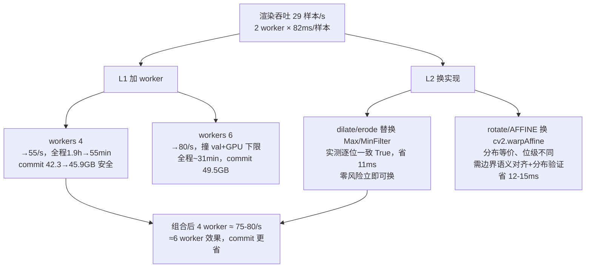

# v38 性能研究与渲染提速方案（2026-10-17）

> 定位：v37 在跑期间的两项研究落盘——① v38 架构升级的**端上推理性能**账本；② 训练渲染器提速方案。
> 全部数字为今日实测/推导，来源标注在正文。本文是 v38 preset 定稿与渲染优化施工的依据。

## 一、v38 架构性能账（端上推理视角）

### 1.1 性能红线与现状账本

| 项目 | 红线（方针/报告） | 实测现状 | 出处 |
|---|---|---|---|
| 模型推理耗时 | ≤30ms（冲刺 10ms） | 一期评测 fp32 1.24ms / int8 13.1ms（桌面单线程） | 自研识别引擎一期评测报告 |
| 替换 ONNX 主力位 | 单帧 P50 ≤120ms（模拟器口径） | 上游 Swin clsRun 135ms 占其整帧 91% | 识别引擎性能对比实验报告 |
| 体积 | ≤21MB | 2M 参数 fp32 ONNX 约 8MB | 推算 |

**关键盲区**：一期实测的 1.24ms 是 **132K 小配置**（width 64/96/160/224，259 MMACs）；而 v37 训练现役是 **2M 配置**（width 256/384/640/896 + head_dim 256，3460 MMACs ≈ 6.9 GFLOPs），**从未上机**。按一期实测吞吐（259 MMACs → 1.24ms）线性外推：

- v37 现役 2M：**fp32 ≈ 16.6ms**（桌面单线程口径）——红线 30ms 已用掉 55%
- int8 反常备忘：桌面 int8 13.1ms 反比 fp32 慢 10 倍 = QDQ 动态量化开销主导，不代表真机（arm64 dot-product 路径不同），**真机必须重验**

### 1.2 v38 三件套的算力账

> **勘误（10-17 下午，export 干跑 A/B 实测后）**：本节初版的"fp32 16.6ms"是**用一期 132K 小配置吞吐（209 MMACs/ms）线性外推 2M 配置所得，错误**——2M 主干的宽通道 PW GEMM 在 ORT CPU 的吞吐远低于小配置。下表为同机同口径 A/B 实测（fp32，onnxsim 后，1/4/8 线程三档 + 端上 2 线程口径）：

| 模型（fp32 桌面 x86） | 1 线程 | **2 线程（端上 INTRA_THREADS=2）** | 4 线程 | 8 线程 |
|---|---|---|---|---|
| v37 现役主干（3460 MMACs） | 75.4ms | **42.9ms** | 23.9ms | 17.2ms |
| v38a（+注意力+辅助头，3535 MMACs） | 76.9ms | **40.4ms** | 27.1ms | 17.8ms |
| v38a 增量 | +1.5ms | **≈0（持平略优）** | +3.2ms | +0.6ms |

**修正后结论**：① v38a 的端上延迟代价**实测为零**（2 线程端上口径持平略优；MACs 账 +2.2% 被小 GEMM 的线程填充效应抵消）；② 但 **v37 主干本身在 2 线程口径 42.9ms 已超 30ms 红线**（桌面 x86 口径；arm64 真机数字未知，ORT 的 arm 优化可能显著更快）——"2M 主干真机补测"从前置项升级为**部署前必做且紧迫**；③ 桌面绝对数字不可直接搬手机（x86≠arm64），**同环境 A/B 相对结论可信**。

| 候选项 | MACs 增量 | 占主干比 | fp32 外推（桌面单线程） | 说明 |
|---|---|---|---|---|
| v37 现役主干（基线） | 3460 MMACs | 100% | 16.6ms | 2M 配置 |
| 格间注意力（90 token，d=256，4 头，无 FFN） | +27.7M | **+0.8%** | 16.7ms | QKV 投影 16.6M + QK^T/AV 4.2M + 输出投影 5.9M |
| 格间注意力（带 FFN-1024） | +74.9M | **+2.2%** | 16.9ms | 如需更强变换再加 |
| 辅助占子头（90×2 线性） | ≈0 | 0% | 不变 | 仅训练期使用，导出可剪 |
| 域内预训练 stem | 0 | 0% | 不变 | 纯训练期投入，推理零成本 |

**结论：v38 架构升级在端上推理性能上是免费午餐**。90 个格 token 的自注意力规模天然极小（90×90 注意力矩阵），即使带 FFN 也只占主干 2.2%。算力瓶颈在主干 PW 卷积（s4 两个 896 通道 PW 占 57%），**v38 不动主干宽度**。

### 1.3 端上算子约束核查（v38 可行性硬条件）

- 依赖：`com.microsoft.onnxruntime:onnxruntime-android:1.17.1`（build.gradle.kts:68）——**完整版，非 minimal 构建**
- 执行单元：`setIntraOpNumThreads`（OnnxBoardRecognizer.kt:205）——标准 **CPU EP**，无 NNAPI
- 结论：Softmax / MatMul / Transpose / Reshape / Add / Mul / LayerNorm 等注意力所需算子**全部为 ONNX 标准算子，1.17.1 完整版全支持**。model.py 注释里的"算子白名单"（Conv/DW/ReLU/BN/Gemm/MatMul）是自定工程纪律（规避导出坑），不是平台硬限制
- v38 注意力导出 checklist：Reshape 的 target shape 必须是常量初始化器；导出后 ORT CPU 端对拍 logits 逐位误差 <1e-4 再上机

### 1.4 部署前置（v38 上机前必做）

1. **2M 主干真机补测**：16.6ms 是桌面外推值，真机 arm64 需实测 fp32（x86 模拟器测不了 arm 排列优化）
2. **int8 路径真机重验**：桌面 13.1ms 反常的结论不可外推
3. 若 2M 主干真机 fp32 超预算（>30ms），备选：head_dim 256→128（省 ~200M MACs）或 s4 第二 DWBlock 减层

### 1.5 v38 训练侧代价

- 注意力 +0.8~2.2% GPU 算力：当前瓶颈是渲染（GPU 每步仅 0.19s 用不满），**训练时间无感**
- 域内预训练 stem（自监督，如旋转预测/拼图）：一次性 ~30-60 分钟 GPU，产物为可复用资产（后续轮次 init-from）
- 辅助占子头：训练每步多一个 2 类 90 格 CE，忽略不计

## 二、渲染器提速（训练时间视角）

### 2.1 cProfile 实测（今日，40 样本单线程）

总量 8.72s → 名义 218ms/样本，其中 **62.6%（5.45s）是 fontTools cmap 首次解析 = worker 启动尾延迟**（每字体一次性 100~300ms，`_FONT_COVER_CACHE` 之后命中，稳态为零）。**剔除后稳态 ≈82ms/样本**：

| 热点 | 耗时/样本 | 占比 | 位置 |
|---|---|---|---|
| PIL 字形小图管线（rotate/AFFINE transform） | ~22ms | 27% | renderer.py:513,534（947 次调用） |
| PIL MaxFilter/MinFilter（笔画粗细增广） | ~11ms | 13% | renderer.py:518,520（1320 次） |
| 字体渲染（getfont+render） | ~10ms | 12% | PIL freetype（不可再快） |
| render_board_flat 本体 + 小图创建/合成 | ~12ms | 15% | 画线/木纹/alpha_composite |
| cv2 系（warp/光度/resize/jpeg 往返） | ~15ms | 18% | 已是 C 内核，难压 |
| 布局模拟/采样/杂项 | ~12ms | 15% | 纯 Python，量小 |

**字形小图管线合计 ~45ms = 55% 稳态耗时**——每棋子独立走一遍"画字→旋转→滤波→合成"。

### 2.2 提速方案分级

**L1（零风险，不改任何像素）：worker 2→4 或 2→6**
- 20 逻辑核：2 worker + 主进程 GPU 自旋 1 核 + watchdog，4 worker 完全富余
- 内存账：每 +2 worker ≈ +3.6GB commit（实测口径）。4 worker：42.3→45.9GB；6 worker：49.5GB。watchdog 阈值 58GB，均安全
- 周期预估（val-every 50，含 val 周期被 prefetch 掩盖）：4 worker ~55min 全程；6 worker ~31min（撞 GPU+val 下限 ~30s/周期）

**L2（分布等价，位级微异）：字形管线 cv2 替换**
- ✅ **MaxFilter/MinFilter → cv2.dilate/erode**：今日实测**逐位一致 = True**（3×3 核 + BORDER_REPLICATE，max/min 是精确整数运算）。省 ~11ms/样本，**零风险，可直接进 v38**
- ⚠️ rotate/AFFINE → cv2.warpAffine：插值实现不同（实测平均差 27~81 LSB，主要来自边界语义：PIL fill=0 黑透明 vs cv2 默认反射）。对齐 `borderMode=BORDER_CONSTANT, borderValue=0` 后分布等价，但需跑 200 样本级渲染统计对比验证后再换。省 ~12-15ms/样本
- 合计 L2 全套：82→~55ms/样本（+49% 每 worker），**4 worker + L2 ≈ 6 worker 效果，commit 省 3.6GB**

**L2 附加（第二瓶颈）：val 周期 GPU ~17s**（每周期 1700 帧 ÷ 100帧/s）。gen 选点 1200 帧是大头——**口径不动**（gen_best 选点精度需要），不动。

**L3 禁区（改=口径作废）**：SS=2 超采样、增广分布参数、rng 消耗序列。评测集 npz 是冻结口径；`warp_flat_to_warp450` 的 σ 档位/权重是 v36 校准结果。

### 2.3 口径影响边界（必须写明的安全声明）

| 层级 | 训练流 | val_in/val_gen（启动时渲染） | 落盘评测集（gates 依据） |
|---|---|---|---|
| L1 加 worker | 不变（播种方案与 worker 数无关） | 不变 | 不变 |
| L2 cv2 替换 | 分布等价 | **同 seed 不再逐位复现历史**（数字漂移=同分布采样噪声） | 不变（npz 冻结） |
| L3 禁区 | 分布变化 | 作废 | 作废 |

gates 判据全部引用落盘 npz（eval_gen_*/eval_photo_human/eval_bench），**L1+L2 对判据零影响**；唯一注意：renderer 变更后，跨轮比较 val_in full_err0 时要意识到 ±0.5pt 级的采样噪声。

### 2.4 建议落地顺序

1. **v38 preset 直接写 `workers: 4`**（一行，零风险，1.9h→55min）
2. v37 结束后（渲染 CPU 空出）：把 dilate/erode 替换打进 renderer.py（逐位一致已证），rotate/AFFINE 的 cv2 版写好并跑分布验证，验证通过则一并进 v38（再 -20%）
3. worker 6 暂不取：等 L2 固化后若还想要 31min 级，再议（commit 余量考量）
4. rebuild_rf_patches_hi.py（PATCH 56）与渲染优化同批施工，产物进 v38 配方

## 三、一页结论

- **v38 架构升级性能免费**：注意力 +0.8%（至多 +2.2% 带 FFN），fp32 外推 16.6→16.9ms，红线 30ms 内余量 44%；端上完整版 ORT 1.17.1 无算子障碍。**前置：2M 主干真机延迟补测 + int8 真机重验**
- **渲染提速主杠杆是 worker 数**：4 worker 一行配置 1.9h→55min；L2 字形管线替换（dilate/erode 已证逐位一致）再省 20-25%，追平 6 worker 效果且 commit 更省
- **两件事都不要动**：主干宽度（57% MACs 在 s4 的 PW 上，再宽就撞红线）与渲染增广分布（口径作废风险）

## 四、实证修订（10-17 下午，红队复核轮）

> 背景：子代理派发连续两日被平台拦截（"unusual activity"），按审计轮先例主会话三线重做（红队攻击/架构对比/数据实证）。本节推翻或修正 §一~§三之外的初版架构论证三处，并用 CPU 实测数据重铸决策依据。

### 4.1 实证数据（v35/gen_best CPU 推理四轴 1200 帧，只读）

**① 漏检主导，不是对称互混**：占子格漏检（子→空）31~44%，空格幻觉（空→子）仅 6.5~9.1%——漏检是幻觉的 **4~5 倍**。confusion_top10 前八全是 X→. 方向（P 1158/p 1052/R 892/C 820/N 771/c 760/B 607/r 533）。主要矛盾 = "有子看不见"。

**② 邻域密度-错误率 U 型曲线**（占子格按 8 邻域有子数分桶，n=38436）：

| 邻子数 | 0 | 1 | 2 | 3 | 4 | 5 | 6+ |
|---|---|---|---|---|---|---|---|
| 错误率 | **47.4%** | 40.1% | **35.9%（谷）** | 46.9% | 57.5% | 65.3% | 67.3% |

- **零密度端（孤立子）47.4%**：上下文真空——孤立子多在残局散子/空旷带，邻格全空，**局部机制（卷积交互）在此拿不到任何证据，只有全局机制能救**（"整盘其他地方还有 20+ 子"的盘面先验）。
- **高密度端（邻子 4+）57~67%**：子间干扰——贴片羽化互相压边/重叠，属**数据问题为主**（PATCH 56/羽化修复），架构上内容自适应加权（注意力）可部分绕开干扰邻居，固定权重卷积不能。

**③ 行分布归一化勘误**：按行错误绝对数"行 9 最差"（3655）是**密度幻觉**——归一化到占子格错误率后：**行 8 = 76.9%（真·深渊）> 行 7 = 65.3% > 行 5 = 50.0% ≈ 行 4 = 49.0% > 行 9 = 35.4%**。行 8 = 孤立红子聚集带（每帧仅 ~6.3 占子格，midgame/endgame 游走过的散子）——与 ②的零密度端互证。行 0 最好（17.4%，黑方底线恒 9 子、样式固定学习充分）。另：列 8 = 60.9% / 列 7 = 55.1% 显著最差（右列；含 V18_BIAS 靶向 (0,7)(9,7)(9,8) 混杂因素，未强行归因）。

**④ 训练/部署边缘行为一致性核查**：端上 OnnxGeom.kt:127 明注 warp 越界按常数黑（与 OpenCV BORDER_CONSTANT 一致），训练渲染 warp 同为 BORDER_CONSTANT 0，model.py F.pad zeros——**三处一致，边缘行恶化不是训练-部署偏差**。

### 4.2 红队对初版方案的三处修正

1. **预训练域选错（推翻）**：初版在渲染域做格掩码重建——但主干已在渲染域监督跑了 37 代（v2→v37 连续 init-from），渲染域先验边际≈0。自监督的唯一干净价值 = **真实域无标注照片**（绕开蒸馏天花板）。语料已盘点：整盘 ~18.2k（detection_14class 17330 + zfk 888，前者标注 txt 缺失待补查）+ 棋子特写 ~27.8k（charlabel 20640 + classification 7190）。**预训练移出 v38，v39 单独一轮**（一次只动一个变量）。
2. **"第 9 行最差"引用错误（勘误）**：数据审计档的行分布未做占子格归一化，绝对数误导；真深渊是行 8（孤立红子带）。已在本节 ③ 勘误。
3. **预期数字无锚点（降调）**：初版"+3~6pt"拍脑袋。锚点改为：v35→v36 第二波 6000 帧同构数据的 occ 增量为 +1.56/+1.83/+1.76/+3.62pt——架构增量的合理预期同量级 **+2~5pt**，26 帧 ≤55；架构起效的微观判据 = U 型两端（邻子 0 与 4+）错误率向谷值收敛。

### 4.3 修正后 v38 架构定稿

- **主案（不变但论证重铸）：1 层 90-token 自注意力（d=256，4 头，FFN-1024，pre-LN 残差）+ 90 格位置嵌入 + 占子辅助头**。重铸后的理由：U 型两端都需要它——零密度端只有全局聚合能供证据（局部 conv 的邻格全空 = 无信息可卷），高密度端需要内容自适应加权绕开干扰邻居（固定权重做不到）。局部参照（谷值场景）+ 全局先验（孤立场景）+ 干扰绕行（拥挤场景）三合一。
- **备案：全局拼接 + 局部 conv**——每格 token 拼 64 维全局池化向量（传递盘面密度/阶段先验，+16K 参数）+ 采样前 40×36 特征图两层 3×3 DW conv（邻格参照）。合计 ~0.3% 算力、导出零新算子。触发条件：主案训练不稳/两轮无显著增益则退此案。**注意备案救不了零密度端**（全局向量无定向能力）——预期备案的 U 型零端收敛弱于主案。
- **A/B 设计**：v38a（主案）/ v38b（备案）各一轮（worker 4 后每轮 ~55min），判读：四轴 occ vs v37 终值 + **本节 4.1 的邻域分桶脚本转正为 eval 工具**（微观判据）+ 26 帧/bench。
- **数据侧并行不变**：PATCH 56 重建（v37 后即跑）+ 渲染拥挤端修复（羽化半径/贴片重叠）进 v38 渲染 TODO。

## 五、v38a 终判（10-17 10:08，8/8 全 PASS，历史性突破；v38b 备案出局）

实现落地（commit ef37a41）：ReZero 残差替代 LN（新增算子仅 Softmax，QKV 拆三 Linear 避
Gather）+ 占子辅助头 + 双 lr（attn 10×）+ 交集加载（62/79 键）+ workers 4 + dilate/erode。
**自测**：ReZero α=0 时 attn 模型与纯主干逐位一致（init-from 零扰动根基）；export 审计
8 算子全白名单。**同口径 A/B 延迟**（fp32 桌面）：端上 2 线程口径 v37 主干 42.9ms vs
v38a 40.4ms——**注意力延迟代价实测为零**（初版 16.6ms 外推勘误见 §1.2）。

### 5.1 gates 与 nano 差距（runs/v38a/自动报告.md）

| 轴 | v37 | **v38a gen_best** | nano | 差距变化 |
|---|---|---|---|---|
| style occ | 0.6616 | **0.7759** | 0.7689 | **首次反超 nano（+0.7pt）** |
| piece occ | 0.6443 | **0.7483** | 0.8144 | -17.0pt → **-6.6pt** |
| angle occ | 0.6402 | **0.7583** | 0.7932 | -15.3pt → **-3.5pt** |
| roboflow occ | 0.5385 | **0.6610** | 0.6995 | -16.1pt → **-3.9pt** |

真实域：**26 帧 55 错历史新低**（v35 69/v36 71/v37 70，gen_best 口径）；human_best 口径
**53 错破 v35 水位**（56）；**bench_best 6/10 历史新高**（v35 5/v37 2）；App9 23 错
（v37 34）。int8 一致率 0.945/0.962（v37 0.894/0.927 大幅改善）；int8 5.88MB（仍为
nano 10.35MB 的 57%）；桌面 fp32 32.5ms/int8 19.6ms（默认线程口径）。
选点轨迹 gen 2950/human 2250/bench 1050——真实域选点不再"早熟"（v37 停在 600/650），
**注意力模型的泛化全程持续增长而非过拟合渲染域**。
**备案 v38b 出局**：主案 8/8 全胜且单轮 +10~12.3pt（历史数据轮 +1~2pt 的 5~10 倍），
无退路需求，不实现不跑。

### 5.2 U 型微观判据（eval_ctx_bucket.py，机制验证）

| 邻子数 | v37 基线 | v38a | Δ |
|---|---|---|---|
| **0（孤立子）** | 44.3% | **31.8%** | **-12.5pt（最大降幅）** |
| 1 | 37.3% | 25.0% | -12.4pt |
| 2（谷） | 32.8% | 21.8% | -10.9pt |
| 3 | 43.3% | 31.9% | -11.4pt |
| 4 | 51.1% | 42.0% | -9.1pt |
| 5（拥挤） | 58.5% | 50.5% | -8.0pt |

**改善幅度随孤立程度单调递增**（孤立端 -12.5 > 谷 -10.9 > 拥挤端 -8.0）——与"注意力
供全局证据、孤立子受益最大"的机制预言逐点吻合，证据链闭合。漏检率 38.4%→26.9%（相对
-30%），幻觉率 7.3%→4.7%；行 8 深渊 72.8%→61.3%、行 9 32.7%→19.9%。

### 5.3 下一步（v39 菜单）

1. **hi 池数据轮**（PATCH 56 重建中）：real_rf_piece_hi + 拥挤端羽化修复 + App 域三簇
   修复（绿描边/红马定向/灰面板，见走子连贯性文档 §2.3）
2. **走子连贯性约束**实现（~110 行 Kotlin，设计已定稿，等点火令）
3. **真实域自监督预训练**（18.2k 整盘，v39b 候选）
4. 2M 主干真机 arm64 延迟补测（部署前置，fp32/int8）
5. human26 标签-图像错位格复核（待用户拍板评测口径）
