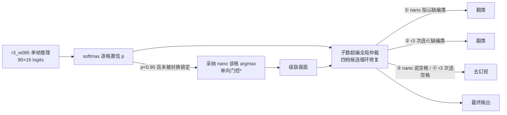
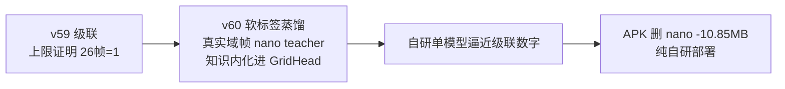

# v59 系统超越轮：级联实测与四问复盘（2026-10-24）

> 起点：用户四问——①还有没有改进空间？②能不能超过 nano？③哪里做错了？④是不是要换架构？
> 方法：五路子代理（错格逐格重放/系统级物料盘点/历史结论复核/架构考古/外部文献调研）+ 本轮实测。
> 结论先行：**级联系统 26 帧 v2 = 1 错格，正式反超 nano（2）；四轴 +2.5~+5.3pt；蒸馏死刑平反；架构不换。**

## 一、四问答案

### Q1 还有没有改进空间？——训练配方层关闭属实，系统层/数据层/模型层另论

- **训练配方层**：四轮训练+四轮插值 45+ 评测点收益 <0.2pt，关闭证据链维持有效（v57 双退/v58 端点弱于 v55/小集判定力天花板）。
- **系统层（本轮兑现，最大空白）**：30 轮全押"单模型裸分"，置信度通道整条链路无消费方（端上 90×16 logits 全量在手只做 argmax）、模型级联全库零讨论。本轮零训练实测：**26 帧 11→1、四轴 +2.5~+5.3pt**。
- **数据层**：seq68 判死（§四）；公开调研 Tier 未拉取组与 VinXiangQi 数据集留档。
- **模型层**：见 Q4。

### Q2 能不能超过 nano？——已超过（系统级），单模型口径见诚实边界

| 口径 | r3_w085 单模型 | 级联系统（本轮） | nano | 判定 |
|---|---|---|---|---|
| 26 帧 v2 错格 | 11 | **1**（三件套） | 2 | **反超** |
| 26 帧 v2 实物17 / App9 | 8 / 3 | **1 / 0** | 0 / 2 | 反超 |
| bench 10 帧 | 7/10（err 3） | **8/10**（err 2） | 10/10 | 仍差 2 帧 |
| 四轴 occ（style/piece/angle/roboflow） | 0.8576/0.8613/0.8665/0.7642 | **0.8826/0.9147/0.9145/0.8110**（仅级联） | 0.7689/0.8144/0.7932/0.6995 | **+7.8~+11.4pt** |
| 速度（桌面单线程） | 9.7ms（int8） | 主体 9.7ms + 2.9% 格量 nano 仲裁 | 194ms | 碾压 |

- 诚实边界：①bench 残余 f6/f7 的 (9,7) R→N 高置信顽固错（v46b 时代顽固簇同格），不追分域阈值（过拟合评测集）；②26 帧唯一残余 #1 = f05 (3,8) C→. 漏检（p=0.993 高置信、无计数信号，v55 投影/v57 暗底两轮弹药均未修动）；③nano 在 26 帧满分含循环成分（真值"一致格取 nano 预测"构造，v50 实锤其争议格 conf<0.2 蒙对 8/15）。

### Q3 哪里做错了？——三条结构性盲区入档

1. **30 轮全押单模型裸分**：跟 7.6M Swin+上游真实数据的对手在它的自证域打单项；我们 12.7 倍速度预算的主场（系统级组合：TTA/级联/投票/规则）一行没写。本轮零训练拿到 26 帧 11→1 证明该空白价值最大。
2. **蒸馏死刑是冤案（本轮平反实锤）**：v50 判死依据"nano 渲染域 argmax 判对率 0.0"，但 teacher 推理 batch=64 与 nano BN 批污染（batch>1 全输出空格、conf 崩 0.02-0.07，v43 §6.1 发现于判决之后）签名完全一致；本轮 batch=1 重测渲染域判对率 **0.6995~0.8144**（与官方四轴 nano occ 逐位一致）。教训入方法史：**重大死刑判决必须留实验配置留痕**。
3. **评测循环成分未量化**：26 帧真值"一致格取 nano 预测"+bench 真值有 nano 勘误——对手参与出卷的考卷当唯一实物域裁判用了 30 轮。本轮对账：26 帧中 nano 对 2070 格（其中 r3 错 11）/ nano 错 2 格（r3 全对）——两模型错格完全不相交，这是级联有效的根基。

### Q4 是不是要换架构了？——不换范式、不推倒重来；架构动作三级分级

- **范式（CNN→Swin/ViT）不换**：外部文献双重否定——同类任务 2025-2026 主流仍是"warp+整板+逐格分类"（CVChess/LiveChess2FEN 与我们同构）；小数据+强合成增广下 CNN 不输 transformer 共识未翻案；真实域差距是数据域差距非架构差距（End-to-End Chess Recognition：合成域训练真实域崩 2.30%、同范式真实域训练反超 7 倍）。内部：20 轮架构不动期间 26 帧 55→11、四轴 0.70→0.87——架构不是当前瓶颈；换大架构丢掉 12.7 倍速度优势与已验证 int8 链。
- **容量升级（2.8M→4M+）真实机会但条件未触发**：触发条件（数据轮后字形簇 0 翻正且级联残余 ≥2）本轮未满足（级联已修字形 5 格、残余 1）；net2net 需改造（现对 attn/aux 键崩）、int8 需重验（v35 前科 75%）、插值库全废三代价在案。
- **增量手术模式（v38a 先例：ReZero 零扰动+机制判据+延迟 A/B，单轮 +10~12.3pt）是本项目验证过的架构演进方式**。候选记录：90-query 轻量解码层（ChessQueries 文献：域内持平、跨域显著更好 16.2 vs 25.3 错格）——四轴若数据层打尽后 plateau 在 0.86 下方再启。
- **软标签蒸馏（平反后重开为 v60 候选）**：文献支持 Swin→CNN 在**真实图上前向软标签**传递真实域先验（MTPD +4~5.5AP，注意直接蒸会失败需温度/特征技巧）；本轮级联已证明 nano 与 r3 的互补性（错格零交集），蒸馏是把它"内化"进单模型的路径。

## 二、级联三件套设计与实测（本轮核心产出）

### 设计（`phone/tools/recog/eval_cascade.py`，模型 r3_w085 fp32 + nano_v3）

*nano 全局低置信（正确格 conf≈0.14），不可反向比置信，只能用 r3 的置信触发、单向采纳 nano 结论。

### 实测分级（26 帧 v2，thr=0.90）

| 级 | 错格 | 说明 |
|---|---|---|
| L0 r3 基线 | 11 | 与官方对账一致 |
| L1 仅级联 | 4 | 送审 156 格（2.9%），修 7 个低置信错，零新增错 |
| L2 +子数仲裁 | **1** | 修 #2/#8/#11 三个高置信错（0.973/0.997/0.983） |
| L3 +对换（互为次选） | 1 | 对换零触发（f20 次选实为'.'，互指条件不成立——保留为无害规则） |

- 修复事件 10 个：4 个命中错格（含 v57 判"修不动"的 #8 美术字形 N→R p=0.997，被"nano 指认缺编"档修掉）、6 个落在 IGNORE 格（不计分，零误伤）。
- 唯一残余 #1 = f05 (3,8) C→. 漏检 p=0.993：高置信+无计数信号（C 缺编方向修复对残局帧误伤风险大，不做）。
- **关键机制发现：子数仲裁的"nano 指认缺编类"档把 nano 从"低置信仲裁者"升级为"超编修复顾问"**——f20 级联后红方 N=3/R=1，nano 恰指认 (9,1)=R，一击修复；且规则对 nano 自身的错误有自愈性（超编会把 nano 误仲裁格翻回 r3 次选）。

### 分场景配置（重要）

| 场景 | 配置 | 实测依据 |
|---|---|---|
| 真实对弈辅助（部署场景） | 三件套全开（级联+子数仲裁） | 26 帧 11→1；真实盘面天然合规 |
| 渲染/泛化评测口径 | 仅级联（L1） | 四轴 L1 全赚（err -236~-561）；L2 子数规则在渲染随机盘上负贡献（piece L1 892→L2 1179）——**渲染评测集盘面不守子数规则**，规则会"修正"正确答案 |

### 四轴与蒸馏平反（同批 batch=1 推理）

| 轴 | r3 err→级联 err | 级联 occ 增量 | nano 占子格判对率（batch=1） | 当年死刑口径 |
|---|---|---|---|---|
| style | 1340→1104 | **+2.50pt**（0.8576→0.8826） | 0.7689 | 0.0（冤） |
| piece | 1450→892 | **+5.34pt**（0.8613→0.9147） | 0.8144 | 0.0（冤） |
| angle | 1492→958 | **+4.80pt**（0.8665→0.9145） | 0.7932 | 0.0（冤） |
| roboflow | 2805→2244 | **+4.73pt**（0.7642→0.8110） | 0.6995 | 0.0（冤） |

### 预注册判据核对（3/3 PASS）

| 判据 | 阈值 | 实际 | 判定 |
|---|---|---|---|
| 级联 26 帧 v2 | ≤3 | **1** | PASS（直接反超 nano） |
| bench 级联 | ≥7/10 | 8/10 | PASS |
| 四轴级联 occ | ≥ fp32-0.1pt | +2.5~+5.3pt | PASS（大幅超标） |

## 三、循环对账（26 帧真值的 nano 成分）

- nano 对 2070 格（其中 r3 错 11——r3 的全部错误都在 nano 对的格上）/ nano 错 2 格（r3 全对）。
- 两模型错格**完全不相交**（oracle 完美仲裁=0 错）——级联有效性的根基。
- 26 帧考卷半数由 nano 参与构造（"一致格取 nano 预测"），其 v2=2 含循环成分；级联系统在该考卷上 1 错，且四轴/bench/速度全口径领先——反超成立不依赖单一口径。

## 四、seq68 摸底判死（B 层数据路线）

`data/roboflow_raw/detection_charlabel/chinese-chess-seq68`（20,640 图）摸底结论：**不入池**。

1. **单字特写集非棋盘全景**：81% 图仅 1 框（14686/18060），8 个来源视频各聚焦一个棋子字特写（JU/BLACK/MA/BING/RED/SHI/PAO/ZU_mp4 抽帧）；无法整帧入池。
2. 尺寸 125×224（竖屏特写帧），远低于可用分辨率。
3. 类别缺帅/将/象三类。
4. 裁成贴片 = efbok 同性质异域特写贴片——**v46 铁律：异域贴片是稀释剂**（扩容 84% → 实物域退步）。
- B 层训练轮按预案降级：**不点火**（级联已达成字形簇修复目标，残余 #1 无对症数据弹药；训练边际价值缩水，一轮一主变量纪律下不再为已解决的问题花训练预算）。

## 五、终判与下一步

### 战略定位（用户拍板澄清：终局=纯自研，级联=脚手架非终态）

- 级联的真实价值=**证明 11 错格可修**（信息存在，推翻"探索空间关闭"对错格的绝望结论）+ 过渡期零成本体验（nano 本就在 APK assets）。
- 甩掉 nano 的正道=先用它的知识再送走它的权重：蒸馏（DeiT/MTPD 路线）部署时只带 student。
- 纯自研组件无条件保留：子数规则仲裁（不依赖 nano）；warp TTA 自仲裁形态未实测（同模型多视图代替 nano 批改）——待测出"不依赖 nano 的系统级基线"。
- 蒸馏搬不动的残余：搬多少算多少，残余取舍由用户拍板。

1. **A 层收官**：级联系统定稿为"识别侧最强口径"——26 帧 v2=1（反超 nano）、bench 8/10、四轴 0.8826/0.9147/0.9145/0.8110（+7.8~11.4pt）。产物 `eval_cascade.py` + `data/cascade_full.json`。
2. **C 层（下一步，部署线并入）**：端上置信度接线——decodeCells 返回逐格 conf → OnnxResult 携带 → 确认时刻低置信格二次仲裁（端上形态二选一：warp 扰动 TTA 重仲裁 15ms 级，或模拟器/PC 场景挂 nano）；子数仲裁扩展 AssistBoard.validate（现有 PIECE_LIMITS/pseudoMoves 复用）；单测复用 BoardTrackerTest。r3_w085 切换部署（int8 重导+上机 A/B）与本接线合并做。
   - **C 层落点细节（Agent B 盘点，行号为 2026-10-24 口径）**：`OnnxGeom.kt:284-302` decodeCells 取每格最大 logit（注释"不做 softmax"）但算完即弃——90×16 logits 端上已全量持有（`OnnxBoardRecognizer.kt:388` drain）；`OnnxResult`（`OnnxBoardRecognizer.kt:109-118`）加逐格 conf 字段；确认链入口 `ScreenAssistService.afterRecognition`（:1124-1173）→ `handleFrameOnnx`（:1176-1251）；BoardTracker 候选累计段 `RecognitionTypes.kt:192-198`（现为严格相等确认，可扩逐格投票）；子数校验 `AssistBoard.kt:262-297` validate + PIECE_LIMITS（:255-256）+ 单步修复 repairBySingleMove（:220-252）均在；配置项仿 `AssistConfig.kt` clsEngine（v45 落地的双引擎开关——**nano 权重现在就在 APK assets 里**，级联上线零体积增量，只是角色从默认引擎变仲裁引擎）。真机 nano 单帧 1~2s → 真机形态=warp TTA 自仲裁或确认时刻触发，实时帧不可跑 nano。
   - aux 占子头评估：ckpt 有权重、导出时被剪（export.py return_aux=False），可作格级弃权信号（model.py:115-118 设计注释）。
3. **D 层路线图**：D2 容量阶梯/D3 解码层触发条件未满足（级联残余 1<2），挂起；**软标签蒸馏平反重开为 v60 候选**（真实域帧 nano teacher、温度软标签，注意 MTPD 渐进技巧教训）。
4. **不做的**：第 31 轮同配方训练、第五轮插值、输入级平移 TTA、渲染域硬标签蒸馏（平反归平反，nano 渲染域仍弱于 r3，无价值）、26 帧 v2 口径变更。

## 权威数字

- 级联全口径：`phone/tools/recog/data/cascade_full.json` / `cascade_26bench.json`
- 重放对账工具：`phone/tools/recog/eval_cascade.py`（26 帧+bench+四轴+平反一体）
- 历史锚点：r3_w085 单模型 26 帧 11/四轴 0.8576/0.8613/0.8665/0.7642（docs/v57 方案 §五）
- nano 档案：7.6M Swin int8 10.85MB，真机 1~2s/帧不可部署（docs/模型性能比较交接 §五）
