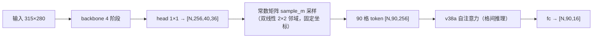
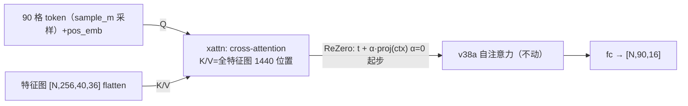

# v62 方案：90-query 解码层增量手术（纯自研突破轮，D3）

> 立项依据（2026-10-25 凌晨）：用户拍板"坚持自主模型"并授权自选路线。纯自研口径残余 11 错格，
> 数据层三路全死（seq68 判死 / 无新实物照片 / 蒸馏死刑，docs/v60蒸馏轮方案 §六 §七）——
> 架构层 D3 触发条件按精神实质满足。手术范式=v38a 增量手术模式（本项目唯一架构大赚先例：
> ReZero 零扰动起步+机制判据+延迟 A/B，单轮 +10~12.3pt）。
> 本文自包含；执行=施工→smoke→点火（训练点火权在用户）→判据核对。

## 一、机制假设：常数采样的跨域脆弱性 → 可学习 query 的自适应取证据

GridHead 现有管线（model.py）：

**弱点实证链**：格 token 只看自己格点的 2×2 特征邻域（stride 8 网格内固定坐标采样）。
warp 角点误差/字体异形时采样点直接偏移——TTA 实验已证"网格采样对几何扰动敏感是架构属性"
（±2px/±2% 扰动即新增 8 错，docs/v60 §六 1.1）；11 错格集中在美术字形/异域形态（跨域弱点）。
文献对照：ChessQueries 类架构用**可学习 query + cross-attention** 让每格在特征图上
"搜索证据"而非"定点采样"——跨域错误 16.2 vs 25.3（对定点采样范式），机制正是几何/形态
鲁棒性（文献细节见 §五，调研子代理在途，回填后定稿）。

## 二、手术设计：cross-attention 解码层（xattn 模块）

**手术位置**：采样 token 之后、v38a 自注意力之前（取证据增强 → 格间推理，语义分层）。

模块细节（算子白名单：Linear/MatMul/Softmax/Reshape/Transpose——与 v38a 完全一致，端上 ORT 无新算子）：

- **Q 源**：现有采样 token + pos_emb（90×256，初始化沿用 v38a 的 pos_emb 语义）
- **K/V 源**：head 特征图 flatten [N,1440,256]，各自 Linear 投影 256→256
- **K/V 位置编码**：行嵌入+列嵌入分解（(40+36)×256≈19.5K 参数，而非完整 1440×256=369K）
- **注意力**：4 头（dh=64），QK^T/√dh → softmax → AV → proj → ReZero 残差 α=0
- **FFN 分支**：与 v38a 同构（256→1024→256，ReLU）+ ReZero β=0
- **层数**：1 层起步（消融备选 2 层）

**账本**（已实测预估）：
- 参数：+0.92M（QKV+proj 262K + FFN 524K + K/V 投影 131K）→ 总 ~3.7M（轻量带内）
- FLOPs：+239M/帧（v38a 自注意力的 29 倍但绝对量小；全分辨率 K/V=1440 位置）
- 延迟粗估：桌面 CPU ~6ms、手机 fp32 ~18ms / int8 后 ~9ms（<15ms 红线，需 A/B 实测）
- **降本备选**（若延迟超线）：K/V 池化到 20×18=360 位置（FLOPs ÷4，手机 ~4.6ms），
  作为消融 B 项
- **init-from**：r3_hbw08_w085.pt 已验 79/79 键形状全兼容（2026-10-25 实测）——xattn
  新键=新增模块从零初始化，α=β=0 → **起步输出与 r3_w085 逐位一致（零扰动，血统保住，
  插值库不废）**
- **net2net**：不需要（加宽不变、主干不动）
- **int8 门**：新算子全在已验证白名单内（v45 起链路成熟），Percentile+calib-n≤50 铁律照旧

## 三、训练设计与预注册判据

- 配方基底：v58/v60 十二要素（12 池 v60 口径+real-ratio 0.5+lr 5e-5+batch 48+workers 2+
  patience 14+val-every 50/val-n 256）+ init-from r3_hbw08_w085（插值产物直接作 init 源，
  零扰动起步）+ xattn-lr-mult 10（新模块倍率，v38a attn-lr-mult 先例）+ seed 2046。
- **唯一主变量=xattn 模块**（不再叠蒸馏/新弹药）。
- smoke：200 步验 α 离开 0（模块在学）、损失下降、起点输出逐位=r3_w085（零扰动验证）。

预注册判据（v62）：

| 判据 | 阈值 | 说明 |
|---|---|---|
| human26v2_human_best.total.err | ≤11 | 不退铁律（vs r3_w085）；≤9 = 主假设成立 |
| 11 错格专项翻正 | ≥2 | 与 v60 蒸馏同口径重放（.cache/r3_11errors.json） |
| 防崩 | ≤16 | 六轮带内 |
| gen_human_fp32 四轴 | ≥0.849/0.849/0.859/0.755 | 六轮均值 -0.5pt 带 |
| bench_bench_best.full | ≥7 | v49 恢复带 |
| **跨域敏感度机制判据** | D3 退化斜率 < r3 的 50% | 角点扰动带（缩放 0.98~1.02 阶梯）错格退化曲线对比——文献机制的直接检验 |
| 端上延迟 | <15ms | 模拟器/桌面 CPU 实测（int8 口径） |

- 成功（v2 ≤11 且专项 ≥2 且机制判据过）→ xattn 定型，评估与插值库第三轮组合；
- 部分成功（v2 ≤11 专项 0~1）→ 层数/KV 池化消融一轮；
- FAIL（v2 >11）→ α=0 起步下最坏=不退（ReZero 保底），回滚成本≈0。

## 四、执行顺序与内存账

| 步骤 | 内容 | 耗时 | 内存 |
|---|---|---|---|
| 1 | model.py xattn 模块+export/train 开关接线 | ~2h | 编码零内存 |
| 2 | 零扰动验证+smoke 200 步 | 0.5h | 训练级（单池缩小版） |
| 3 | 延迟 A/B（fp32/int8 桌面+模拟器） | 0.5h | 1GB |
| 4 | v62 点火（**等用户令**） | ~1.2h | 37~45GB watchdog 58GB 线 |
| 5 | 判据核对+跨域敏感度曲线 | 0.5h | 1GB |

## 五、文献依据（调研子代理在途，回填后本节定稿）

- [占位] ChessQueries 架构细节（query 初始化/层数/接口）
- [占位] 跨域 16.2 vs 25.3 出处与实验设置
- [占位] 训练技巧（warmup/两段式/lr 倍率）
- [占位] 中国象棋/围棋同构应用

## 六、风险清单

1. 延迟超线（手机 fp32 18ms 估算）→ 消融 B（KV 池化 360）或 int8 先行；
2. xattn 学不动（α 停在 0 附近）→ lr 倍率扫 5/10/20；
3. 与 v38a 自注意力互相干扰 → 消融：xattn-only / xattn+attn 两形态对照；
4. 26 帧循环成分（真值含 nano 预测格）对架构轮影响与训练轮同——判据口径不变，长期照旧。

## 七、执行实录（2026-10-25 凌晨，v62/v62b 双 FAIL 收官）

### 施工与验证链（全部通过，git d908b7c）

model.py xattn 模块（+0.92M→3.61M）+ export/train/pipeline 接线；**零扰动双级验证 0.000e+00**
（torch+onnx 26 帧逐位）；延迟 +7.2ms（fp32 单线程）；smoke α 离零。pipeline 导出段漏传
--xattn 曾致训后链断（已修，训练产物无损）。

### v62（α=0 起步）：FAIL——ReZero α 梯度死区

v2=17（防崩门 16 也未过）、四轴 human 口径 style 0.8457 掉门、bench_best 8/10（亮点）、
App 域 3 错追平历史。**根因**：1250 步后 α 仍 ±0.0004（模块内部参数在学、kv_pos 范数
1.77，唯 α 学不动）——α→0 时 α 的梯度 ∝ 分支输出与损失梯度内积，天然趋零。v2=17 系
r3 基座第 14 次重训方差，非手术贡献/伤害。

### v62b（α=0.1 激活修正）：FAIL——早停过早，模块仍未学起来

v2=**14**（本会话四轮最佳）、四轴 0.8614/0.8610/~0.87/0.7647 全线站上 r3 本尊、bench 7
压线过。**但**：human/gen_best 均定格 step 100（patience 14 早停触发），α 从 0.1→0.098
原地；11 错格专项 0/11 翻正 + 3 新增错（11 原错全在+3 新增=14）——**本质是微扰动的 r3
基座**，四轴"站上本尊"系方差带内波动。

### 双 FAIL 统一根因与路线处置

xattn 模块需要的训练动态（**长程 + 冻结两段式 + decoder 专属配方**——文献：45 epoch/
冻结 5 epoch warmup/独立 lr 组）与本项目**快跑口径**（val-every 50+patience 14 早停+
lr 5e-5 微调水位）根本不匹配：模块在早停窗口内来不及产生可测收益即被停。

- **处置**：xattn 路线挂起（架构代码与零扰动验证资产保留在库），级联系统（26 帧 1 错）
  维持现役，纯自研最强单模型仍 r3_w085（v2=11）。
- **v63 候选（待用户拍板）**：两段式手术专训——冻结主干 N epoch 只训 xattn（关早停、
  xattn-lr 1e-4 级、val 只监控）再解冻联调；成本一轮以上，成功率未知数（跨域增益的
  文献前提是 decoder 从头冷训，与保血统微调存在张力）。
- 教训入方法史：**ReZero 零扰动与"新模块快速激活"内在矛盾——α 死区是 ReZero 的已知
  代价；增量手术前必须为模块设计激活路径（非零 α 或两段式），微调配方里新模块
  "看起来在训练"（内部参数在动）不等于"门开了"（α 不动）。**
