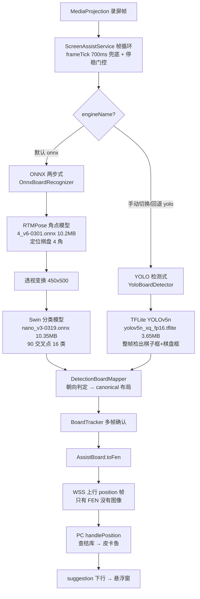

# YOLO 识别管线研究报告

日期：2026-10-03 ｜ 性质：**纯研究，未改动任何产品代码、未删除任何模型文件**

## 一、结论先行

1. **识别全部在手机端**：录屏帧 → 手机识别引擎 → FEN 上行 PC。PC 端（识别服务程序）`grep yolo|onnx` 零命中，PC 不参与像素识别。
2. **默认链路上 YOLO 确实被架空（证据强度：高）**：出厂默认引擎是 ONNX 双模型（`AssistConfig.recognizerEngine = "onnx"`），YOLO 仅在两处入口被调用——用户在主页手动切到"YOLO 检测式"、或 ONNX 加载失败自动回退。正常用户永远不会触达 YOLO 推理。
3. **您看到"cnvcs 象棋被识别成功"，干活的其实是 ONNX，不是 YOLO**。这个困惑的根源是把两个并行引擎混为一谈："别人的引擎"（onnxruntime + RTMPose 角点 + Swin 分类，移植自 GPL 上游 上游识别器项目，已获作者许可）才是识别主力。（2026-10-03 勘误：YOLO 模型与解码/映射代码来自**另一个**上游 Vincentzyx/VinXiangQi，与 上游识别器项目 无关——两个引擎两个上游，初版报告未区分，来源表见第二节。）
4. **YOLO 本身也能识别 cnvcs**（实测 `dets=33 pieces=32 avg=0.93`）——但即便它不行也不影响默认链路。
5. **cnvcs 兼容之谜的答案**：识别方案是通用几何 + 分类（定位棋盘 4 角 → 透视变换 → 逐交叉点分类棋子），代码里没有任何按 App 包名分支的逻辑。只要画面里有标准象棋盘，换任何 App 皮肤都能识别——cnvcs、象棋迪克均已实测。
6. **硬盘账本**：删 YOLO 模型只能省 **3.65MB/APK**（占比 15%），大头是 ONNX 双模型 20.6MB（识别主力，不可删）。真正可回收的硬盘在别处：`phone/tools/quantized/`（20.6MB，可再生脚本产物）、`reference/`（≈95MB，gitignored 参考拷贝）、build 缓存。
7. **建议暂不摘除**：YOLO 是 ONNX 加载失败时的唯一兜底（无模型文件/ORT 崩溃时识别彻底不可用）。3.65MB 换一条保险丝，性价比合适；若您仍决定摘除，影响面清单见第六节。

## 二、识别管线全景

两个引擎是**并列关系**（二选一），不是调用关系——不存在"onnx 架空 yolo"或反之的内部依赖。

### 模型与代码来源（两个引擎、两个上游，2026-10-03 勘误补记）

| 引擎 | 模型文件 | 上游项目 | 移植内容 |
|------|---------|---------|---------|
| ONNX 两步式（默认主力） | `4_v6-0301.onnx`（RTMPose 角点）、`nano_v3-0319.onnx`（Swin 分类） | github.com/上游作者/上游识别器项目 | `OnnxBoardRecognizer` 移植自其 OnnxRecognizer（已获作者许可） |
| YOLO 检测式（回退） | `yolov5n_xq_fp16.tflite`（YOLOv5n 640×640 fp16，输出 [1,25200,20]：14 种棋子 + 1 个棋盘框共 15 类） | github.com/Vincentzyx/VinXiangQi | 模型本体 + 解码/过滤策略：`YoloPostprocessor`、`DetectionBoardMapper` 移植自其 GetBoardFromPrediction 并加强，类别表与其训练定义一致 |

代码注释出处：`OnnxBoardRecognizer.kt:10`、`YoloPostprocessor.kt:11`、`YoloDetections.kt:9`、`DetectionBoardMapper.kt:10`。

## 三、架空判定证据链

**代码证据**：

| # | 证据 | 位置 |
|---|------|------|
| 1 | 出厂默认 `recognizerEngine = "onnx"` | `AssistConfig.kt:44` |
| 2 | 引擎分发：只有 `engineName == ENGINE_ONNX` 不成立才走 YOLO | `ScreenAssistService.kt` handleFrame 分发 |
| 3 | YOLO 热路径仅两个入口：主页单选手动切换 / ONNX 加载失败回退 | `AssistActivity.kt` RadioGroup、`ScreenAssistService.kt` switchEngine |
| 4 | PC 端零命中：`git grep yolo\|onnx`（internal/、cmd/） | — |
| 5 | 历史实测记录"cnvcs 打谱下 YOLO 全链路成功"——证明 YOLO 是**可用备用**而非死代码 | `phone/tools/LATENCY_NOTES.md` |

**实测证据（2026-10-03 模拟器，cnvcs 对局）**：

| 实验 | logcat 证据 | 结论 |
|------|------------|------|
| ① YOLO 引擎选中时 | `yolo: infer=122ms crop=1072x1344 dets=33 pieces=32 avg=0.93`、`rec(yolo): pieces=32 orient=STANDARD issue=0` | YOLO 管线完整可用，对 cnvcs 检出 32 子 |
| ② 主页切到 ONNX | `switch engine: yolo -> onnx` → `onnx engine: ready` | 切换按钮生效，会话重建 |
| ③ 切换后 YOLO 静默 | 清空 logcat 后 `yolo: infer` 计数 = **0**，同窗口 `rec(onnx): pieces=32 fen=rn2kab2/... 186ms` | 同一画面只调用选中引擎；ONNX 接管后识别照常 |
| ④ 主页单选状态 | `rb_engine_yolo checked="true"`（切换前）→ 点击 ONNX 后生效 | 设置持久化、UI 与引擎状态一致 |

## 四、cnvcs 兼容之谜

识别管线**不看 App 是谁**：

- **ONNX 路径**：RTMPose 回归"棋盘 4 角"这种通用几何关键点 → 单应变换拉成正俯视图 → Swin 对 90 个交叉点逐个分类"空/红帅/黑马/…"。它认识的是**棋子长什么样**，不是某个 App。
- **YOLO 路径**：整帧检出 14 类棋子框 + 棋盘框，再映射到 9×10 网格——同样与皮肤无关。
- 全仓 `grep cnvcs` 零业务分支命中（只有注释与测试记录）；不存在按包名的模板库。
- 实测佐证：cnvcs（全屏自绘）与象棋迪克（不同几何）均识别成功，`LATENCY_NOTES.md` 还记录过"cnvcs→象棋迪克切换后棋盘几何完全不同也能跟随"。

## 五、硬盘占用账本（实测）

| 项 | 大小 | 说明 |
|----|------|------|
| `yolov5n_xq_fp16.tflite`（打进 APK） | **3.65MB** | YOLO 回退引擎 |
| `models/4_v6-0301.onnx`（打进 APK） | 10.2MB | RTMPose 角点（识别主力①） |
| `models/nano_v3-0319.onnx`（打进 APK） | 10.35MB | Swin 分类 int8（识别主力②） |
| `phone/tools/quantized/` | ≈20.6MB | 量化脚本产物，**可再生**，不进 git |
| `reference/` | ≈95MB | GPL 上游参考拷贝，gitignored，不进版本库 |
| `build/intermediates` 模型缓存 | 24MB×4 组 | 删 build 目录即消失 |

APK 体积角度：模型合计 24.2MB，YOLO 占 3.65MB（15%）——摘除 YOLO 对 APK 瘦身收益有限。

## 六、若将来摘除 YOLO 的影响面（本报告仅列出，未执行）

1. `assets/yolov5n_xq_fp16.tflite` 删除（-3.65MB）
2. 整删 `YoloBoardDetector.kt`、`YoloPostprocessor.kt`、`YoloDetections.kt`
3. `DetectionBoardMapper.kt` **不能整删**——`screenOrientation` 被 ONNX 路径复用，需剥离保留
4. `ScreenAssistService.kt`：yoloDetector 初始化（onCreate 无条件加载 tflite 进内存，注释已标明）、handleFrameYolo、回退逻辑、yoloPacer、引擎常量等约 12 处
5. `AssistConfig.kt` engine/useNnapi 字段、`AssistActivity.kt` 单选 UI 收敛为单选项或移除
6. `build.gradle.kts` 移除 tensorflow-lite 依赖
7. `OnnxBoardRecognizer` 加载失败路径改为纯报错（失去兜底）
8. 测试裁剪（DetectionBoardMapperTest 等）

**代价**：ONNX 加载失败（模型缺失/ORT 崩溃/机型不兼容）时识别彻底不可用，无自动兜底。

## 七、自研模型路径建议

当前架构已把"识别"抽象为两个接口位，自研模型可直接替换、不动管线：

1. **角点位**：替换 `4_v6-0301.onnx`——输入 256×256 仿射图、输出棋盘 4 角（SimCC 或热图均可），对齐 `OnnxBoardRecognizer.detectCorners` 的预处理/后处理即可。
2. **分类位**：替换 `nano_v3-0319.onnx`——输入 280×315 俯视裁剪、输出 90 交叉点 × 16 类 logits，对齐 `classifyCells`。
3. 自研模型训练数据可用现有管线自动采集：识别确认后的帧 + FEN 即是天然标注（棋盘已定位、每格已分类），无需人工标注。
4. YOLO 路径的两步确认/裁剪推理（cropHint）逻辑可作为自研检测模型的工程参考，替换完成后一并清理。
