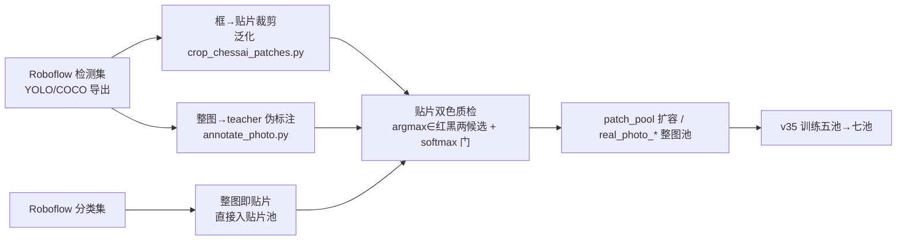

# 公开数据集调研（v35 弹药侦察，2026-10-07）

> 目的：为 v34 之后的数据杠杆寻找新弹药。v34 实证"每个新真实域数据源=离散涨分"（chessai 一源 +3.2pt 三轴），
> 本轮目标是把真实域供料线从 1 个源扩到一篮子。纪律照旧：**外部数据集仅训练自用、不分发、不进 git、逐源记录出处**。

## 〇、一句话结论

主战场在 **Roboflow Universe**（象棋检测集密度远超预期）：首扫 "chinese chess" 枚举约 25 个项目，
用户补充 2 条线索后按 "xiangqi" 二次扫描又新增约 20 个（两口径合计约 45 个、重叠 10 个），
其中完整 14 类分红黑检测集合计约 2 万图；HuggingFace/GitHub 侧除已集成的 chessai-data 外无新货；
TheOne1006 demo 数据集 Google Drive 链接**复核仍 404**（与 2026-10-03 结论一致）。

## 一、Tier A：优先拉取（检测集、红黑口径、许可宽松）

| # | 项目 | 图像数 | 类别 | 许可 | 备注 |
|---|---|---|---|---|---|
| A0 | [312s / xiangqi-super-dataset](https://universe.roboflow.com/312s-workspace/xiangqi-super-dataset) | **4460** | board + 14 类分红黑 | 待核（同 workspace 的 A5 已核 CC BY 4.0） | **全场最大完整口径集**，xiangqi 口径二扫发现；下载时与 A5/A8 去重核对是否为其母集 |
| A1 | [NT Newbie / chinese-chess-seq68](https://universe.roboflow.com/nt-newbie-nheyt/chinese-chess-seq68) | **8600**（2 版本） | 8 类（red/bing/black/ju/ma/pao/shi/zu，命名混乱） | CC BY 4.0 | 最大单集；类目口径可疑（red/black 混作类名），拉取后必须过 teacher 贴片双色质检审计 |
| A2 | [zouling / chess-3j3vb](https://universe.roboflow.com/zouling-iolcl/chess-3j3vb) | 690（v13=473，4 版本合计取全集） | **14 类完整分红黑**（b_che…r_shuai） | CC BY 4.0 | 缩略图看是真实棋盘照片，口径最干净 |
| A3 | [FINALTEST / chinese-chess-fpt](https://universe.roboflow.com/finaltest-lqish/chinese-chess-fpt) | 685 | 14 类完整分红黑（越南语命名 ma_den/do…） | 页面待核 | 与 chessai 同为越南团队产物但**分红黑**，恰补 chessai 最大短板 |
| A4 | [MQinsulator / chess-abplc](https://universe.roboflow.com/mqinsulator-o4udf/chess-abplc) | 673 | 14 类分红黑（与 A3 同命名体系） | 页面待核 | 疑与 A3 同源或姊妹集，合并去重 |
| A5 | [312s / xiangqi-standard-pieces](https://universe.roboflow.com/312s-workspace/xiangqi-standard-pieces) | v3=**1037**（页面显示 556 为浏览数） | 14 类分红黑（black_king…red_rook） | **CC BY 4.0（已核）** | 名为"标准棋子"，疑似棋子特写图 → 直接喂贴片池；官方模型 mAP@50 99.3 暗示图质高、噪声低 |
| A6 | [Bananas / scan-xiangqi](https://universe.roboflow.com/bananas-workspace-lcecp/scan-xiangqi) | **1500** | 14 类分红黑 | 页面待核 | xiangqi 口径二扫发现，量级第二 |
| A7 | [chess-yyrn7 / robot-pi](https://universe.roboflow.com/chess-yyrn7/robot-pi-j9a5f) | **1390** | 越南语 14 类分红黑（xe_den/phao_do…） | 页面待核 | 棋牌机器人项目，疑实拍 |
| A8 | [312s / xiangqi-scara-yolo26](https://universe.roboflow.com/312s-workspace/xiangqi-scara-yolo26) | 892 | 14 类分红黑 | 待核 | 312s 家族第三集（6 个模型） |
| A9 | [ccq / xiangqi](https://universe.roboflow.com/ccq/xiangqi-c8ogg) | 747 | 14 类分红黑 + chessboard 类 | 页面待核 | 含棋盘整类标注 |
| A10 | [pieces / xiangqi-chess-pieces-omg](https://universe.roboflow.com/pieces-j6xyl/xiangqi-chess-pieces-omg) | 743 | 红黑棋子（中英混合命名） | 页面待核 | — |
| A11 | [hhb / xiangqi](https://universe.roboflow.com/hhb-kgv8h/xiangqi-s7nwg) | 520 | 14 类分红黑 | 页面待核 | — |
| A12 | [detect-rhm8j / xiangqi-chess](https://universe.roboflow.com/detect-rhm8j/xiangqi-chess)（**用户补充**） | 75 | 14 类分红黑（b-jiang…r-shuai，页标 15 类疑含空类） | **CC BY 4.0（已核）** | 小而完整，凑批零头 |

## 二、Tier B：分类集（可直接当棋子贴片池）

| # | 项目 | 图像数 | 类别 | 备注 |
|---|---|---|---|---|
| B1 | [test1 / chinese-chess-classification](https://universe.roboflow.com/test1-tgsdm/chinese-chess-classification-efbok) | **7190** | 10 类：1-帅…10-象 | 疑与 Heywhale"7200 张 10 类"同源；分类图即现成贴片池 |
| B2 | [Chinese Chess / chinese-chess-classification](https://universe.roboflow.com/chinese-chess-belvh/chinese-chess-classification) | 3160 | 0–13（疑 14 类编号） | 待拉取时核对类别表 |
| B3 | [bottle / chinese-chess-7jmoo](https://universe.roboflow.com/bottle-eagin/chinese-chess-7jmoo) | 8590 | red/bing/black/ju/ma/pao/shi/zu | 与 A1 同命名体系疑同源，若与 A1 重复只取其一 |
| B4 | [faiz albar risi / xiangqi](https://universe.roboflow.com/faiz-albar-risi-hesz7/xiangqi-chinese-chess) | 225 | hitam_*/merah_* 7 类分红黑（印尼语） | 小而干净 |

## 三、Tier C：部分类别/特殊形态（视 A 组收益决定）

| # | 项目 | 图像数 | 类别 | 备注 |
|---|---|---|---|---|
| C1 | [2s Workspace / chinese-chess-fyce5](https://universe.roboflow.com/-mqu7z/chinese-chess-fyce5) | 5080 | back/defect/stain + 红黑 車馬炮 | 智能棋盘工程系列，俯拍特写、同质化高；車馬炮恰是混淆重灾字，作贴片池补充 |
| C2 | [s-workspace-olzvh / chinese-chess-qkj2g](https://universe.roboflow.com/s-workspace-olzvh/chinese-chess-qkj2g) | 3362 | 同 C1 体系 | 与 C1/[chinese-chess_ju](https://universe.roboflow.com/s-workspace-q6mth/chinese-chess_ju)（2830）同家族，去重后合并 |
| C3 | [HungRen Lai / chinese-chess-detection](https://universe.roboflow.com/hungren-lai-s-workspace/chinese-chess-detection-sehut) | 603 | back + 红黑車馬炮 | 同上 |
| C4 | [Phuong Ha / chess-n05df](https://universe.roboflow.com/phuong-ha-yng6s/chess-n05df) | 1040 | board + 混合棋子类 | 含棋盘类标注，口径杂 |
| C5 | [Viktor ng / chinese-chess-rtpmq](https://universe.roboflow.com/viktor-ng/chinese-chess-rtpmq) | 200 | 12+ 类（含 intersection 交点类） | 交点类对我们无意义，棋子框可取 |
| C6 | [Nguyn Ngc Thch / board-dataset](https://universe.roboflow.com/nguyn-ngc-thch/chinese-chess-board-dataset) | 127 | Board/Palace/River 实例分割 | 棋盘结构分割，几何管线远期参考 |

小集合（28~512 图，多数 14 类分红黑或 B/R 两色）：quang-tung（130）、lam-hoang-phuc（79/135）、project-xdges（248）、
chinese-chess-belvh detect（200）、hommoner 实例分割（221）、nofor-ya（497/230）、Jennys（200）、NguyenBao94（163）、
dang-minh-nguyen（229，B_A/R_K 代号）、chess-cpa8i（137）、huus（795，字母代号）、class-yolo（219，b_1~r_7 编号）、
myworkspace（57）、yings（35）、HNNU（77）、xiangqi-bz9hx（44）、huudeptrais（35）、workspace-fnuls（50）、
cwj（28/64）、Osaka（36）等，合并凑批可作贴片池零头。

## 三½、Tier D：关键点/分割集（几何管线弹药，服务 angle 轴短板的端上侧）

| # | 项目 | 图像数 | 类型 | 标注 | 备注 |
|---|---|---|---|---|---|
| D1 | [DuyTranLe / xiangqi-ubjij](https://universe.roboflow.com/duytranle/xiangqi-ubjij) | **1500** | 关键点检测 | board + 红黑 14 类棋子双标注 | **关键点+棋子二合一**，几何与识别弹药一体，二扫最大惊喜 |
| D2 | [chess-zen / xiangqi_board](https://universe.roboflow.com/chess-zen/xiangqi_board)（**用户补充**） | 276 | 关键点检测 | xiangqi_board（棋盘角点/交点） | **CC BY 4.0（已核）**；棋盘几何真值，直接对照我们 warp 管线的角点误差 |
| D3 | [MyRobot / chess-robot-pose-detection](https://universe.roboflow.com/myrobot-wuh2o/chess-robot-pose-detection) | 50 | 关键点检测 | b_che、r_shuai 等 | 小批凑数 |
| D4 | [EMO / chinese_chess_seg](https://universe.roboflow.com/emo-c11ky/chinese_chess_seg) | 1220 | 实例分割 | chess 单类 | 棋子掩码，远期可做抠子贴片 |
| D5 | [xiangqi-game](https://universe.roboflow.com/xiangqi-game/xiangqi-game) / [xiangqi-2](https://universe.roboflow.com/xiangqi-caq95/xiangqi-2) / [bigboardds](https://universe.roboflow.com/hands-muhdb/xiangqi-bigboardds) | 745/721/697 | 实例分割 | board+pieces（bigboardds 加 river） | 棋盘结构分割，几何管线远期参考 |
| D6 | [tesst / board-seg](https://universe.roboflow.com/tesst-syby0/board-seg) / [chinesechess inters](https://universe.roboflow.com/chinesechess-licdm/seg_chinese_chess)（404）/ board inter（497） | 316/404/497 | 分割/交点 | 单类 | 交点检测与我们格心公式对照用 |

## 四、与我们管线的对接



- **裁剪/质检脚本复用**：`.cache/crop_chessai_patches.py` 的 COCO→贴片+帧集一体逻辑泛化为"任意框标注集"入口（YOLO 格式转 COCO 一层薄壳）。
- **红黑判定**：越南语/印尼语/英文类名统一映射到我们的 16 类记号（VN2DUAL 式映射表逐集写）。
- **质检门不放松**：所有外部框先过 teacher 双色质检（argmax∈红黑两候选且 softmax≥0.55），A1 这种类目可疑的集子尤其依赖这道闸。

## 五、下载途径与许可纪律

- **Roboflow 下载需免费账号 API key**（roboflow pip 包或网页导出 YOLOv8/COCO 格式）；代理已就绪。
- 已核实许可：A1/A2/A5 = CC BY 4.0（允许训练使用，要求署名）；其余逐集下载时核对页面许可标签。
- 纪律不变：仅训练自用、不分发、不进 git（data/ 下外部原始集一律 gitignore）、出处逐源登记本档与新增文件清单。

## 六、排除项与死链档案

| 来源 | 结论 |
|---|---|
| [TheOne1006/chinese-chess-recognition](https://github.com/TheOne1006/chinese-chess-recognition) | demo 数据集两个 Google Drive 链接 2026-10-07 复核**仍 404**（pose demo / cchess_reg demo）；HF 仅有其预训练 ONNX 无数据集 |
| [chessai-data](https://huggingface.co/datasets/vietanhdev/chessai-data) | 已集成（v34），HF 镜像与 GitHub 同源 872 图，无需重下 |
| Kaggle | 无实质性象棋图像数据集 |
| CSDN"2100 张 13 类分割"系 | 营销博文型资源，原始仓库不明确、大概率付费墙，且多为 Roboflow 集的再打包，跳过 |
| 飞桨 AI Studio / Heywhale | 有 10 类分类集，但需平台账号；与 B1 疑同源，优先走 Roboflow 通道 |
| 学术论文（polibatam 2025 等） | 未随文公开数据集 |

## 七、预估弹药量

两关键词（chinese chess + xiangqi）合计枚举约 45 个项目：完整 14 类分红黑检测集合计约 **2 万图**（A0~A12 主力）、
分类贴片池约 1.2 万（B1~B3）、关键点/分割几何弹药约 5600（Tier D）、其余为小集合与部分类别集。
对比 chessai 单源 868 图/18790 框带来 +3.2pt 三轴，本篮子是它的 **50 倍量级起点**（同质化与去重打折后仍是十倍级）。
真实域整图池有望从 4119 跳到 2 万+，远超 v35"池加码"所需；执行时按 A0→A2→A6/A7→B1 顺序分批拉取质检，不求一次吃下。

## 八、下载执行记录（2026-10-07，API key 用户提供）

实际落地 **14 个项目版本、46165 图、1.3GB**（data/roboflow_raw/，gitignore；每集 meta.json 记出处/版本/类别）：

| 项目 | 实际 | 与预估差异与注意事项 |
|---|---|---|
| xiangqi-super-dataset v1 | 4455 | 16 类=14 分红黑+board+chess-piece；owner 预处理 **512×512 拉伸**（几何畸变，质检注意） |
| chinese-chess-seq68 (NT Newbie) v2 | **20640** | 预估 8600 的 2.4 倍；类目=字类 ju/ma/pao/shi/zu/bing + **red/black 独立类**（颜色信息需 teacher 判定，同 chessai 工作流）；同名类双 id 按映射 |
| chinese-chess-classification-efbok v1 | 7190 | folder 格式（train/valid/test×10 类文件夹） |
| robot-pi-j9a5f v7 | 3601 | 预估 1390 的 2.6 倍；越南语 14 类，**tuongx=tướng(王)/tuong=tượng(象) 映射假设待视觉核验** |
| xiangqi-scara-yolo26 v9 | 1734 | 512×512 拉伸同上 |
| xiangqi-chess-pieces-omg v3 | 1005 | **类目塌缩**（仅 N/river 两类），14 类在老版本，待补拉 |
| chinese-chess-fpt v5 | 1645 | vua_den/vua_do 明确王类，越南语 14 类 |
| xiangqi-s7nwg (hhb) v6 | 1248 | 14 类+objects |
| scan-xiangqi v1 | 1500 | 14 类+scan-xiangqi 兜底类 |
| xiangqi-standard-pieces **@v3** | 1037 | 最新版只剩 57 图（已下载），v3 经 `@3` 语法补拉成功 |
| xiangqi-c8ogg (ccq) v4 | 747 | 存在**同名类双 id**（映射须按 id 不按 name） |
| chess-3j3vb (zouling) v16 | 690 | 14 类+chess 类 |
| chess-abplc (MQ) v1 | 673 | 越南语 14 类+chess |
| detect-rhm8j/xiangqi-chess | **0** | 作者从未生成 version，非所有者无法导出，放弃 |

下载器：`.cache/rf_download.py`（COCO/folder 双格式、`@版本号` 覆盖、轮询等待导出、meta.json 落盘，暂不入库）。
三个工程坑入库：①versions 实为**列表**非字典；②导出端点 format 是**路径段**（`/{ws}/{proj}/{ver}/coco`）非查询参数；
③classification 项目仅支持 folder/clip 格式。

## 九、下一步（质检与入库）

1. 泛化 `.cache/crop_chessai_patches.py` → 多集 COCO/folder 统一入口，按 §四 类名映射表逐集转 16 类记号；
2. 全部框过 teacher 双色质检闸（argmax∈红黑两候选且 softmax≥0.55），产出 patch_pool_rf.npz + 贴片帧集；
3. 每集抽 112 格拼图人工核验（重点：robot-pi 的 tuongx/tuong 假设、NT Newbie 颜色判定、512 拉伸集的畸变容忍度）；
4. 质检通过后并入 v35 训练池（photo 池 + 贴片池再加码），与 2M 容量阶梯同轮验证。

## 十、归档与合规（2026-10-07）

**目录结构**（data/roboflow_raw/，按任务类型分门别类）：

```text
data/roboflow_raw/
├── ATTRIBUTION.md            # 逐集出处+许可+使用声明（CC BY 4.0 合规署名）
├── detection_14class/        # 14 类分红黑检测集 ×10（约 17.3k 图）
├── detection_charlabel/      # 字类标注检测集 ×1（NT Newbie 20.6k 图）
└── classification/           # 分类贴片池 ×1（7.19k 图）
```

**许可核验**：13 个项目经 API `project.license` 字段逐一核验，**全部 CC BY 4.0**（允许训练使用，要求署名）；
署名表与使用声明（仅训练自用/不分发/不进 git）落盘 `data/roboflow_raw/ATTRIBUTION.md`。

**垃圾清理**：删除 xiangqi-chess-pieces-omg（类目塌缩无监督价值）、standard-pieces 废弃 57 图版本；
meta.json 均在集内随目录移动，路径自洽。

### 8.1 用户本地导入：chess_material_zfk（2026-10-07 体检入库）

- 来源 `D:\12567\Videos\chess_dataset`：**888 图 / 28302 框**（去重后；"All Types"为三材质纯重复合集未导入），
  14 类红黑棋子检测（red_ma/black_jiang 拼音系，YOLO+VOC 双标注严格同步、无空标签），
  亚克力 298/不锈钢 290/木质 300，163MB → `data/external/chess_material_zfk/`（文件名加材质前缀）。
- 体检结论：固定机位抽帧（781×700/780×704 统一）存在近重复帧；无许可文件，按"用户本地提供，仅训练自用"登记；
  实拍实体棋子**离格散布/任意旋转/倒字/亚格偏移/重叠**——正中 piece 轴与"路边摊实体子"病灶，三种新棋盘材质。
- 质检路线：颜色已知 → **单候选** teacher 闸；class_map_16 已写入 meta.json（red_ju→R … black_jiang→k）。
- 划分 txt（Linux 路径+All Types trainval 损坏）弃用；12 个 .cache 弃用。
