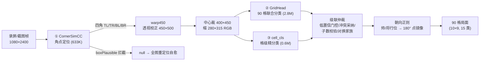

# 技术文档：中国象棋识别系统（GridHead）

> 本系统由 AI 自主训练完成（GLM-5.3 / GLM-5.3-Flash / DeepSeek-V4.1-Flash 驱动
> 方案设计、代码实现、训练与评测裁决）。本文描述识别链的架构、数据体系、评测方法
> 与部署口径；训练过程的来龙去脉见《我们来时的路》。

## 1. 总览

识别链分三段，逐段收敛问题规模，末段用规则级联仲裁兜底：



类别表 `".xKABNRCPkabnrcp"`（15 类）：`.` 空、`x` 占位不可辨、大写红方
K帅 A仕 B相 N马 R车 C炮 P兵、小写黑方 k将 a士 b象 n马 r车 c炮 p卒。
标签网格 10 行×9 列行主序，row 0 = 图像顶部。

## 2. 角点定位：CornerSimCC

- **架构**：stem conv（stride2）→ 6 段 DW 骨干（通道 64→128，逐段 stride2 至 8×8）
  → 1×1 压通道 → GAP → 两个 FC 头。共 633K 参数。
- **SimCC 目标**：把真值角点坐标换算到 256×256 affine 空间，对 x/y 各生成一维高斯
  软标签（512 bin，σ≈2），KL/CE 损失求和；推理 argmax(bin)/512×256 解码。
- **窗语义（关键）**：输入窗=**长边方形窗**（短边 pad），1.25 padding 全图 affine。
  竖屏大棋盘场景下 1.25 宽窗会系统性切掉半盘（v63 screen30 首考实测 27/30 帧出窗
  → 定位错还自信输出错局面），方形窗是为此的根因修订。
- **角点语义**：输出四角=棋盘**网格交叉点** A0/A8/J0/J8（不是外框/装饰线）——
  这是 warp 后格线对齐的硬约束。
- **质量门**：`boxPlausible`（宽高比/尺寸/内角合理性）拦截不合理输出；训练含
  负样本（非棋盘帧 ~5-10%）教模型压平峰值。失败语义=宁 null 不错点。
- **训练数据**：在线渲染整屏工厂（`renderer.py`+`corner_data.py`：板型/角度/占比/
  透视/遮挡/渐变/照片背景/软件 UI 背景，角点 GT 解析自证）+ 真实域注入（录屏帧
  人工几何定案真值 + 照片域双模型一致伪标签）。关键分布参数：棋盘高度占比下限
  bh_lo=0.30（复盘 App 小棋盘场景）、透视 kst_max=0.48、旋转 ±35°。

## 3. 整板识别：GridHead

- **输入几何**：warp450（500 高×450 宽）→ 中心裁 400×450 → 缩 **280×315** RGB →
  ImageNet 归一化。
- **架构**：四段 DW 骨干（通道 256/384/640/896）+ head-dim 256，每格一个 token，
  **格间注意力**（90 token 自注意力，ReZero 残差 α 起步）+ **占子辅助头**
  （该格是否占子，aux-weight 0.4——强迫特征对占子敏感，遮挡格 ignore）。
- **损失**：15 类 CE（空格权重 0.8 / 占子 1.6）× **格条件类平衡**
  `w(cell,cls) = clip(√(全局频率/格内频率), 1, 6)`——消除"位置-类绑定"先验
  （如 (9,7) 马位格车识别率仅 11.5% 的格条件失衡病）。
- **训练**：AdamW lr 5e-5 / cosine / warmup 400 / bf16 / batch 48 / 150K 样本；
  13 个真实域池按 real-ratio 0.5 混入渲染流（渲染:真实≈1:1）；三尺选点
  （gen 四轴 / human26 / bench 各存 best.pt）+ **deploy 终局复选**（rank 融合）。
- **训练集（13 池 ~45K 帧）**：渲染流 + 真实域池（照片域伪标签清洗池、实物贴片
  移植池、bench 热格移植池、空格反面证据池、roboflow 框-格映射池等），来源见
  [ATTRIBUTION](../ATTRIBUTION.md)。评测集永不入训（排除清单断言强制）。

## 4. 格级精分类：cell_cls 与级联仲裁

cell_cls 是 90 格独立小分类器（0.6MB，48×48 格图输入），只在级联里对低置信格
说话。级联四通道（阈值 v63 封版：THR=0.90，CTHR=0.60，CONF=(0.92,0.95)）：

1. **低置信门控**：pmax < 0.90 的格若 cell_cls 置信 ≥0.60 且原判非帅/将 → 采纳重判
   （单向：高置信格永不被推翻）。
2. **冲突采纳**：r3 高置信（≥0.92）∩ cell_cls 更高置信（≥0.95）且两者不一致、
   涉帅将除外 → 采纳 cell_cls。
3. **子数校验**：占子数 <8 的帧先过规则修复再入级联。
4. **对换家族**：{马⇄象} 置信互补对（cell 5/6、12/13）argmax/second 对称 swap。

级联实战效果：26 帧金口径 v2 从纯 r3 的 11 错收至 **2 错**（v63 实测）。

## 5. 朝向正则

照片/录屏可能黑方在下。帅(2)/将(9) 的行位判 STANDARD（红下）/FLIPPED（黑下），
FLIPPED 时对 90 格预测做 180° 点镜像（`g[::-1, ::-1]`）。无帅将检出 → 报坏帧。
判朝向发生在**预测之后**，识别模型本身两种朝向都直接面对。

## 6. 数据工厂

- **renderer.py 渲染域**：46 训练字体 + 3 泛化 held-out 字体；5.5 万枚贴片库
  （多来源裁片，K/将帅不贴）；光度弹药（暗角/渐变/水印/蓝白主题/巨字红字）；遮挡
  （灰面板/棋盘 App 界面模拟）；`cell-balance` 频率表由 `stat_cell_freq.py` 统计。
- **真实域注入纪律（血泪换来的铁律）**：纯渲染 100 分≠真实可用（v4 角点纯渲染
  真实域 0/30 的教训）；每个真实池入池前过双闸（双模型一致 / 编制校验）；
  `make_photo_warp_pool.py` 是半监督样例（伪标签+一致格 IGNORE，IGNORE 格
  `ignore_index` 跳过）。
- **评测隔离**：评测源文件排除清单落盘（`corner_excl.json` 式），数据工厂入池前
  代码断言零交集。

## 7. 评测体系（五套考卷）

| 考卷 | 规模 | 测什么 |
|---|---|---|
| eval_human26（v2 口径） | 26 帧（实物 17+App 域 9）人工逐格真值 | 金口径端到端准确率 |
| eval_bench | 10 帧难例（热格/贴片干扰） | 顽固错误位 |
| eval_gen 四轴 | 1200 帧渲染（字体/棋子/角度/贴片轴） | 泛化 occ |
| eval_screen30 | 30 帧仿真屏，三环（定位/识别上限/端到端） | 部署形态端到端，FAIL-wrong 防线 |
| eval_nano17 | 17 局上游对照（full-err-k） | 与外部参照系对账 |

方法纪律：**判据预注册**（presets `gates` 段，训练前定死不退线）、baseline 对拍
delta 列、评测数字全部入档。现役口径：26帧v2=11（级联后 2）、screen30 环1 30/30、
环3 FAIL-wrong=89、四轴 occ 0.86 带（对参照 nano 全面领先）。

## 8. 部署口径

- **fp32**（现役）：三件套共 ~14.8MB；桌面 CPU 延迟（latency_bench 口径）r3
  12.6ms / int8 9.2ms / nano 141ms（多线程），端上建议按机型实测 NNAPI/XNNPACK。
- **int8 已弃**：端上 int8 部署口径 26 帧 24 错 vs fp32 11 错（+13），Percentile
  校准/QAT 不足以回收，路线放弃。
- 导出 opset 白名单（Conv/Gemm/Relu/BN/Pad/Transpose/Reshape 等），权重内嵌单文件。

## 9. 复现指引

```bash
pip install torch onnxruntime opencv-python numpy
python fetch_fonts.py                                   # 字体（OFL）
python pipeline.py --preset v66 --run-name demo         # 一键训练+评测+报告
python eval_human26.py runs/demo/human_fp32.onnx        # 金口径
python eval_screen30.py --corner-pt runs/demo_corner/best.pt  # screen30 三环
```

配方库 `presets/` 每轮一个 JSON：唯一主变量 + 预注册 gates；`pipeline.py` 自动出
`自动报告.md`（含判据逐条 PASS/FAIL 与上轮 delta）。
