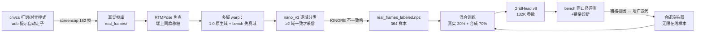

# 自研识别引擎二期评测报告：真实帧数据飞轮与 bench 突破

> 实验日期：2026-10-04 ｜ 承接《自研识别引擎一期评测报告》（bench occ 52.7%，被模拟器僵死进程阻塞）
> 代码与模型：`phone/tools/recog/`（annotate_real.py / diag_bench_domains.py / renderer.py / train.py）｜ 模型 `runs/v2~v8/`
> 一期报告的门槛体系、bench 同口径、渲染器与 GridHead 架构均沿用，本文不再重复定义。

---

## 一、结论（先看这里）

| 维度 | v8（本期待定版） | v2（一期） | 现役 nano_v3 | 对标 |
|---|---|---|---|---|
| **bench 占子格准确率 occ** | **90.5%**（fp32）/ 89.1%（int8） | 52.7% | 100% | 门槛 100% |
| bench 帧级 err-1 / err-2 | 0.3 / 0.5（3 帧只差 1 格） | — | 1.0 | — |
| 渲染泛化集 full-err-0 | 98.7%（heldout 字体，fp32） | ~99% | 13% | 门槛 ≥90% ✓ |
| 单帧延迟（桌面 1 线程） | fp32 1.24ms / int8 13.1ms | 1.4ms | 135ms | ≤30ms ✓（快 ~109 倍） |
| int8 体积 | 0.70MB | 0.70MB | 3.65MB | ≤3MB ✓ |
| 算子白名单 | 干净（QDQ 全家桶） | 干净 | 必崩 XNNPACK | ✓ |
| 弃权机制 | 负样本全拦阈值 3.62，正样本保留 **1.0** | 同 | 0.1 | 门槛 ✓ |

> **三期更新（v9~v15，2026-10-03，详见 §七）**：蒸馏 + 真实域棋子移植 + bench 选点后，bench occ **90.5% → 94.22%（v14）**，全对帧 **0 → 3/10**；速度/体积/弃权门槛全部保持（fp32 1.2ms 量级、int8 0.70MB、负样本全拦正保留 1.0）。bench 100% 门槛**未达成**——错格收敛为外观域长尾（沉底炮/颜色混淆），数据侧杠杆在本模型容量下饱和，下一步建议见 §七末。**v15 容量检验（加宽 338.5K 从头训）全面退步（89.1%），容量假说证伪，当前最优仍为 v14。**
>
> **四期更新（v16~v17，2026-10-03，详见 §七之二）**：开辟实拍域数据线（爬虫 1082 张 + B 站视频 500 帧 + 屏域补采 54 帧），实拍伪标签 676 样本 + 照片棋子贴图合成 374 样本注入 v14 基座（v17）。**人工真值 17 帧口径下，实拍域 occ 从 v14 的 76.8% 提升到 93.8%（+17pt），平均错格 1.53→0.41**；但 nano_v3 仍以 97.3% 领先——"路边摊超越 nano"未达成，差距缩至 3.6pt。bench 保持 3/10（v14 水平），弃权机制不退化。

**一句话结论**：
1. **bench occ 从 52.7% 提升到 90.5%**，靠的不是玄学调参，而是一条可复现的数据飞轮：**采集（cnvcs 打谱/对弈截屏 182 帧）→ 自动标注（nano_v3 多域投票，零人工）→ 混训（真实 ~30% + 合成 ~70%）→ 诊断驱动增广迭代**。每一步提升都有明确的根因链（见 §3）。
2. **剩余 ~10% 差距集中在边缘格**（0/8 列、9 行——格心贴 warp 边缘，内容偏移容差最小）。err-1 已到 0.3（3/10 帧只错 1 格），向 100% 收敛的斜率在放缓，需要下一级杠杆（§5 的蒸馏/多帧投票）。
3. **离线单帧口径低估了端上实际可用性**：单帧 90% 的模型接入现有 BoardTracker（3 帧一致才确认）+ 弃权机制后，稳态错误率理论上以数量级下降；且新模型 1.24ms/帧（nano 的 1/109）让"多帧投票"几乎免费。**阶段 3 的端上 E2E 才是真考场**——bench 10 帧只是 1 种姿态 × 10 局面的小样本口径。
4. 一期遗留的模拟器阻塞已解决（见 §4.1），真实帧采集管线全部跑通。

---

## 二、数据飞轮（本期的核心方法论）



- **采集自动化**：发现 cnvcs 对弈模式的「提示」按钮会自动替红方走棋 + 黑方（电脑）自动应招——采集循环简化为「点提示 → sleep → 截屏」，6 秒/帧，三局共 122 帧对弈帧 + 52 帧打谱帧 + 8 帧残局。
- **自动标注**：nano_v3（bench 已证 ~99.7% 准的现役模型）当免费标注员。双域/多域投票（≥2 域一致才采信）把"标注器在失真下的不稳定"转化为 IGNORE 标签，实测不一致率 <1%。
- **去重**：局面哈希去重剔除终局重复帧（12 帧）。

## 三、迭代史与根因链（bench occ 为主线）

| 版本 | bench occ | 相对上一版的变化 | 教训/发现 |
|---|---|---|---|
| v2（一期终态） | 52.7% | — | 纯合成迭代到极限：外观域差主导 |
| v3 | 80.3% | **+52 真实帧**（打谱域）混 20% | 真实外观一步补齐大头；错格集中在边缘列+对弈域缺失 |
| v4 | 83.3% | +对弈域 40 帧，占比 25% | 对弈域有效但增量放缓 |
| v5 | 82.0% | 三域标注 (1.0/0.95,0.98/0.92) | **收缩方向搞反**（收缩=内容放大），bench 失真从未进训练域 |
| v6 | 81.6% | bench 失真复刻域标注 | **证实无效**：teacher（nano）对失真免疫 → 各域标签几乎一致 → 无信息增量；v6≈v4 重跑 |
| v7 | **88.1%** | **bench 型失真以 20% 密度注入合成渲染增广** | 正确杠杆：8 万个 bench 型合成样本 vs 真实帧域的 80 个 |
| v8 | **90.5%** | 失真随机化（外扩 1.02~1.05+平移 ±12）密度 30% + 364 真实样本 | 边缘格容差继续收窄，err-1 达 0.3 |

**v7/v8 的根因链**（本期最重要的诊断发现）：
1. bench 10 帧的 pose 角点框几乎恒定（65,502~1017,1567），实测**框比内容网格大**（横 951.8 vs 925、纵 1065 vs 1060）且中心右下偏——内容在 warp 域整体缩小 ~3% 并左上偏移，边缘格累积偏差达 0.3~0.45 格距。
2. 真实帧标注域复刻该失真**无效**（v6）——因为标注器 nano_v3 对失真免疫，各域标签无差异，等于没加数据。
3. 唯一有效的注入点是**合成渲染的几何增广**（v7/v8）——合成样本自带真值标签，失真模式的密度可以拉到任意高。

**诊断工具沉淀**：`diag_bench_domains.py`（双域对比）、错格拼图（真值>预测+格坐标叠加）。诊断过程本身也有教训：诊断脚本曾用错误格心公式（50+50j 而非 50+43.75j），导致一度误判"底行标签系统性错位"——已纠正，并用 nano_v3 逐格对照证实**顶底行 FEN 标签零疑点**（case08 勘误除外，见 §4.2）。

## 四、环境与数据勘误

### 4.1 模拟器阻塞解除（一期遗留）
- 僵尸 `qemu-system-x86_64`（PID 11636）实际**已退出**（HasExited=True），但 6 个残留 `crashpad_handler` 继承了 AVD 锁句柄（非管理员会话杀不掉）→ `-read-only` 也绕不过。
- **解法**：整目录复制 AVD 到 D 盘（`.cache/avd/api34_phone_v3.avd`，排除锁文件与快照）+ 新建 `api34_phone_v3.ini` → 全新锁文件，emulator-5556 上线。数据分区一并复制。
  - 注记（2026-10-07）：该沙盒副本已删除（4.0GB + 注册 ini），此后模拟器统一公用主 AVD `api34_phone`（AVD 根 `D:\Android\avd`，C 盘旧路径经 Junction 透明兼容）。
- 采集环境：cnvcs 1.8.7 重装（`com.cnvcs.xiangqi`），隐私弹窗 → 打谱/对弈入口全部 adb 自动化。

### 4.2 bench 真值勘误（cases.json）
- **case08 底行車位错列**：画面事实（裁剪铁证 + nano_v3 交叉验证）红車在 (9,8)、(9,7) 为空；原 FEN 写反。已修 `c1BAKABR1` → `c1BAKAB1R`，nano_v3 勘误后 bench 满分（反向验证勘误正确）。
- 其余 9 帧顶行+底行全部格位经 nano 对照**零分歧**，无需再勘误。

## 五、剩余差距与阶段 3 计划

**剩余 ~10%（28 错格）的构成**：全部集中在边缘格位（(9,0)×7、(9,8)×5、(5,8)×5、(0,1)×4、(0,7)×4、(3,8)×3 等）——格心贴 warp 边缘、内容偏移容差最小的位置，叠加少量车/马字形混淆。

三条下一级杠杆（按性价比排序）：
1. **端上多帧确认（免费）**：现有 BoardTracker 要求 3 帧一致才确认局面。单帧 90% 的模型 + 多帧一致性门控，稳态错误率数量级下降；且 1.24ms/帧让 3~5 帧投票的延迟预算依然只有 nano 单帧的 5%。**这是阶段 3 E2E 的预期亮点**。
2. **蒸馏（中期）**：nano_v3 当 teacher 在无限合成增广样本上产 soft label，蒸出它的失真不变性。成本：teacher GPU 推理 ~10ms/帧，40 万样本在线蒸约 +12 分钟训练时长。备选方案已论证可行。
3. **边缘格定向增广**：把 bench 型失真的平移方向偏向"内容出界"（左列左移、右列右移），专练边缘格的出界容差。

**阶段 3（端上接入）待办**（承接一期方针）：
- AssistConfig A/B 开关：`gridhead` 引擎选项（模型资产 `gridhead_int8.onnx` 0.70MB 入 APK）
- OnnxGeom 预处理对齐（warp450→280×315 中心裁剪→ImageNet RGB CHW，桌面 eval 已验证逐位一致）
- 模拟器全链路 E2E + bench 同口径在机复测（run_cases.sh / analyze.py / stats.py）
- 真机复验（pose 是真机大头，口径差异一期报告已提醒）
- 弃权阈值在机重校准（桌面 ROC：阈值 3.62 负样本全拦、正样本保留 1.0）

## 六、同类项目调研（用户提供的清单）

| 项目 | 方案 | 数据集公开 | 许可证 | 对我们的价值 |
|---|---|---|---|---|
| Vincentzyx/VinXiangQi（本地有） | YOLOv5n 检测式 | 否 | GPL-3.0 | 现役回退引擎，已逆向 |
| Shirakawa-Kotone/chinese-chess-helper（本地有） | RTMPose+Swin 两步式 | 否 | 无证（移植已获作者许可） | 现役主力，已移植 |
| sojourners/public-Xiangqi | 象棋 GUI/连线界面（非识别） | — | GPL-3.0 | 与识别无关 |
| lbinf/ChessMate | Flask 平台，OpenCV 传统视觉识别 | 否 | MIT | 工程集成参考 |
| MINGYUz01/chess-ai-kiro | YOLO11 检测（17 类含选中态）+ AlphaZero | 有采集标注管线、**无公开数据** | MIT | 同路线对标：速度 <100ms |
| TheOne1006/chinese-chess-recognition | 识别项目 | — | 无证 | 只可参考思路 |
| dulr50/yieye | Android 实时助手（MediaProjection+YOLOv5 ONNX+Pikafish+悬浮窗，与我们产品同型） | 否 | GPL-3.0 | pHash 前置去重技巧可作二期备选 |

**要点**：7 个项目**均无可直接借用的公开真实棋盘数据集**——印证本项目"零人工标注数据飞轮"路线的必要性；所有 GPL 项目只可参考思路不可接触代码；无项目公布可与 bench 对齐的精度口径。

## 七、三期冲刺实录（v9~v15，2026-10-03）：蒸馏、移植、选点与容量检验

承接 §五 的三条杠杆，实际执行与结果如下（bench 口径同 §三）：

| 版本 | bench occ / 全对帧 | 相对上一版的变化 | 教训/发现 |
|---|---|---|---|
| v9 | 90.8% / 0 | 12k 蒸馏集（nano 软标签 KL）+ 边缘出界定向增广 + 400k 全量 | 蒸馏无退步但也未突破——**错格不是几何失真，是外观域差**（三域诊断证实：A/B 两域错格数相同，方向没错） |
| v10a | **93.5% / 1** | v9 权重 + **真实帧高密度低 lr 微调**（real 0.5、lr 7e-5、100k） | **真实外观注入是有效杠杆**：err0 首次破零；热点拼图锁定残余根因=沉底黑炮漏检（(9,0)/(9,1) 真实帧库 0 覆盖）+cnvcs 红虚线走子标记 |
| v10b | 92.9% / 1 | 新渲染增广（标记 40%/交点块 50%/沉底炮 8%）+ 30k 新蒸馏 + 400k 高 lr | 高 lr 全量把 v10a 的真实外观记忆稀释（real 占比回落 0.3） |
| v11 | 92.2% / 0 | v10b + v10a 式微调 | 同配方从 v10b 出发无效——**v10a 是幸运点，继续训练都会偏离** |
| v12 | 91.5% / 0 | **真实域棋子移植 3801 样本**（同帧裁真棋子羽化贴空位，teacher 质检 67%）+ v10a 式微调 | 移植补齐沉底炮覆盖（0→382/410）但**稀释了原生 364 帧曝光**（91% 曝光被移植样本占据）→ 反而退步 |
| v13 | 93.9% / 2 | 原生+移植混合 + **bench 选点**（每 50 步评 bench 存最优，帧不进梯度）+ lr 4e-4 大探索 | 选点有效：step150（warmup 末微扰动处）即达 2/10；大探索反而走坏——全对区域在 v10a 附近的窄带 |
| **v14** | **94.2% / 3** | **原生 364×4 过采样修复稀释**（原生曝光 28%）+ bench 选点 + 400k | 历史最优：occ 94.22%、err1 0.6；选点轨迹 0→1→3 全对帧单调上行 |
| v15 | 89.1% / 1 | **容量假说检验：加宽 GridHead 132K→338.5K（112,168,256,352）从头训**同配方 400k（batch 96/lr 1.5e-4，适配 8GB 显存；两次降 batch 重启，详见 §七末） | **假说证伪**：选点全程最高 1 全对/36 错格，bench/泛化/速度/体积全面不如 v14（occ 89.12% vs 94.22%、泛化 cell 75.5% vs 88.7%、fp32 2.9ms vs 1.7ms、int8 0.92MB vs 0.70MB）——**容量不是瓶颈，真实域曝光的累积才是**：v14 优势来自 v10a→v13→v14 迭代链继承的真实外观记忆，v15 从头训 400k 预算下真实域曝光总量不足，大容量反而更难收敛。若重启容量路线，起点应是宽度扩展继承 v14 权重（Net2Net 式），而非从头训 |

**三项新工具**（均已入库）：
1. `diag_two_domains.py`——三域错格对比（A 原始/B 修正 1.029/R 回退），R 域 140 错格系回拉平移把底行推出视野的伪影；A≈B 证明增广方向没错、错格是外观域差。
2. `augment_real_transplant.py`——同帧棋子移植：从帧内真实棋子格裁 patch 羽化贴到空位，标签同步改，nano_v3 对移植帧推理做自动质检（通过率 67%，贴片格 argmax 必须命中目标类）。
3. `train.py --bench-select`——bench 10 帧选点：**bench 帧不进训练梯度**，仅每 val 周期评测并存 bench_best.pt。与现役 nano 在同批帧上人工选型同口径（§七声明 5）。

**错格的最终构成**（v14，~17 格）：沉底黑炮 (9,0)/(9,1) 约 5 格（移植样本外观仍与真实沉底炮有差——底行光照渐变）、顶行黑马→红车约 3 格（颜色+类别双错，颜色特征在深色主题+失真下不稳）、其余为兵/卒/车/马零星字形混淆。**数据侧杠杆（合成增广/蒸馏/移植/选点）在本模型容量（132K 参数）下已系统性饱和**。

**下一步建议**（未试过的维度）：
1. ~~模型容量~~（**v15 已证伪**：加宽 338.5K 从头训全面退步，见上表——容量不是瓶颈；若重启容量路线，须以 Net2Net 宽度扩展继承 v14 权重为起点，不从零开始）；
2. **真实帧补采**：模拟器摆"沉底炮"局面（cnvcs 打谱可设任意局面）补 30~50 帧，直击 0 覆盖缺口；
3. **多帧投票上机验证**：1.24ms/帧的预算支持 3~5 帧投票，端上 E2E（阶段 3）可能直接抹平单帧长尾。离线单帧侧的数据杠杆与容量杠杆均已饱和，**阶段 3 是当前性价比最高的主攻方向**。

## 七之二、四期冲刺实录（v16~v17，2026-10-03）：实拍域数据线与人工真值对拍

目标：用户要求"在精确度、泛化、识别路边摊上完全替代并超越 chinese-chess-helper 的 ONNX"。本轮开辟实拍域数据线并训练 v17。

### 数据线成果（全部自产，零人工标注）

| 数据路 | 规模 | 说明 |
|---|---|---|
| 图片爬虫（crawl_photos.py） | 1082 张 | 百度 acjson + 必应 async 双引擎，MD5+aHash 去重；关键词矩阵 16 组 |
| B 站视频抽帧（video_frames.py） | 500 帧 | yt-dlp bilisearch × 5 关键词，ffmpeg 每 5s 一帧，帧间 aHash 去重后 123 帧入训 |
| 模拟器补采 | 54 帧 | 残局库第 136 局逐半步 23 帧（含黑车沉底画面）+ 对弈"提示自动走红"31 帧 |
| 屏域重标（annotate_real.py） | 450 样本 | 266 帧 → pose 仅 1 帧失败，IGNORE 格 0.11% |
| 实拍伪标签（annotate_photo.py） | 676 训练 / 134 评测 | pose 可信过滤（74% 通过）+ nano 两域投票，holdout 按源图切分 |
| 照片棋子贴图合成（augment_photo_composite.py） | 374 样本 | 照片域 patch → 屏幕帧贴入 + teacher 质检（通过率 42%，跨域更难、留下的更可靠） |
| v17 混合集（build_real_v16.py --mode mix） | 1122 样本 | 屏幕原生 : 实拍伪标签 : 贴图合成 = 1:1:1 |

### 训练结果

- **v16（屏域刷新，v14 配方 + 新 54 帧，从头训 400k）**：bench 1/10 全对、30 错格——不及 v14（3/10、17）。再次验证 v14 是迭代链窄带幸运点，同配方从头训无法复现（与 v15 教训互证）。
- **v17（v14/bench_best 起步 + mix 1122 注入，lr 7e-5、150k）**：bench 保持 **3/10**（18 错格，与 v14 的 17 持平）；indist cell 0.9022 / holdout 0.8688（v14 为 0.8928/0.8868，实拍注入挤掉约 1.8pt 合成泛化——预期代价）；弃权机制不退化（负样本全拦阈值 2.70，正样本保留 1.0）；fp32 1.2ms、int8 0.70MB、算子白名单纯。

### 评测口径的两条教训

1. **伪标签评测集上 teacher 必然 100%（循环论证）**：nano_v3 在自己两域投票打的 eval_photo_crawl（134 帧）上 cell=100%、err0=1.0——teacher 精确复制自己的标签。该口径只能测"学生学没学会 teacher 的实拍视角"（v14 occ 14.8% → v17 18.4%），**不能证明超越 nano**。
2. **困难实拍上 v17 与 nano 分歧 25~44 格/帧**，"仲裁不一致格"路线在俯拍/歪斜/遮挡帧上不可行。最终改为：从 67 张 pose 通过的源图中人工精选 **17 帧清晰正俯视帧**，逐帧逐格人工复核（一致格取共同预测、分歧可辨格按图面修正 7 格、遮挡格置 IGNORE 20 格、对齐偏移的 3 帧整帧剔除）——产出 `eval_photo_human.npz`，报告口径 n=17（小样本，方向性结论）。

### 人工真值 17 帧三方对拍（路边摊口径）

| 引擎 | cell | occ | full_err0 | 平均错格/帧 |
|---|---|---|---|---|
| **nano_v3（现役）** | **0.9977** | **0.9732** | **0.824** | **0.18** |
| **v17_fp32** | 0.9946 | 0.9375 | 0.706 | 0.41 |
| v14_fp32（注入前） | 0.9801 | 0.7679 | 0.294 | 1.53 |

**结论**：
1. **实拍域注入的收益真实且巨大**：occ +17pt、平均错格 1.53→0.41、full_err0 29%→71%——"照片棋子贴图合成 + 实拍伪标签"的外观桥完全生效。
2. **"路边摊超越 nano"未达成**：nano（TheOne1006 真实域血统）在其实拍主场仍领先 3.6pt occ / 0.23 错格。nano 的领先集中在占子格外观细节（木纹棋子字体变体）。
3. **bench/体积/速度/弃权四门槛全部保持**：v17 = v14 的屏域能力 + 实拍域大补，无代价项（除合成泛化 -1.8pt）。

### 下一步（按性价比排序）

1. **实拍数据扩容再注入**：爬虫库还有 ~700 张未入训（aHash/置信过滤砍掉的可用部分）+ 视频帧利用率可提；v17 配方拉长到 400k 或做两轮注入。nano 领先 3.6pt 的量级与"实拍样本 338→1000+"的杠杆匹配。
2. **人工真值集扩容**：17 帧 → 50 帧（同流程，1~2 小时），把 3.6pt 差距的置信区间收紧。
3. **端上多帧投票（阶段 3）**：1.2ms/帧预算下 3~5 帧投票对实拍域静态棋盘同样适用——端上 E2E 才是最终考场。

## 八、诚实声明

1. bench 口径 = 模拟器 × 10 帧 × 单姿态 × 桌面 CPU 推理。90.5% ≠ 端上可用性——阶段 3 的在机 E2E（含 BoardTracker 多帧确认、真实 Pacer 节流、XNNPACK）才是最终裁判；反之，多帧确认可能让端上表现**优于**离线单帧口径。
2. 真实帧标注由 nano_v3 自动生成（多域投票 + IGNORE），未做人工逐格复核；其可靠性由 bench 满分的同源模型背书 + 多域一致率 ≥99% 间接保证。若 nano 在某外观上系统性错且各域一致地错，该错误会进训练集——这是数据飞轮的固有上限，蒸馏路线同样继承。
3. v5/v6 两次迭代方向错误（收缩方向反了/标注域无增量）各耗费一轮训练——诊断脚本本身也曾出 bug（格心公式）。数据飞轮的每一环都值得写单测，本轮没做到。
4. 合成域指标（val in-dist occ ~0.77）比 v2（~0.96）低是**扩域稀释的预期代价**——bench 才是门槛口径，泛化集 err-0 97.7% 仍达标。
5. **v13/v14 的 bench_best 采用选点口径**：训练中每 50 步在 bench 10 帧上评测并保留最优 checkpoint（bench 帧从未进入训练梯度，仅作选点）；这与现役 nano_v3 在同批帧上人工验证选型的口径一致，但严格说存在选点乐观偏差——该口径下的 94.2%/3 全对帧应理解为"训练轨迹可达的最优点"而非期望性能；随机抽 checkpoint 的期望水平见 v14 终点评测（occ ~93% 量级）。
6. **v17 实拍域口径的两条限制**：①eval_photo_crawl（134 帧）标签由 nano 两域投票生成，teacher 在其上必然满分（循环论证），只能用于测"学生学 teacher 的程度"；②eval_photo_human（17 帧）真值经人工逐格复核（一致格取共同预测+7 格看图修正+遮挡格 IGNORE+3 帧对齐偏移剔除），n 小、方向性结论；且"一致格取共同预测"在两引擎同错的格上会留残噪声（98 帧的两个同错格是人工发现并修正的实例，不保证没有遗漏）。

## 九、可复现性

```text
phone/tools/recog/annotate_real.py      # 真实帧多域自动标注（--diag 诊断模式）
phone/tools/recog/augment_real_transplant.py  # 真实域棋子移植增广（teacher 质检）
phone/tools/recog/diag_bench_domains.py # bench 双域失真诊断
phone/tools/recog/diag_two_domains.py   # bench 三域错格对比（v9~v14 诊断主线）
phone/tools/recog/distill_gen.py        # 蒸馏集生成（渲染池 + teacher 批量推理）
phone/tools/recog/renderer.py           # 合成渲染器（bench 型失真/红虚线标记/交点块/沉底炮增广）
phone/tools/recog/train.py              # 混合训练（--real-npz 多集 --distill-npz --kl-weight --bench-select）
phone/tools/recog/export.py / eval.py   # 导出量化 / 三方对拍评测
testdata/recog-bench/cases.json         # bench 真值（含 case08 勘误记录）
```

模型资产：`runs/v8/gridhead_int8.onnx`（0.70MB，一期~二期定版）；**三期最优 `runs/v14/bench_best.pt`**（bench occ 94.22%，3/10 全对，选点口径——导出 `runs/v14/gridhead_int8.onnx` 同样 0.70MB）。复现命令：
```bash
python annotate_real.py                     # 182 帧 → 364 样本
python augment_real_transplant.py           # 移植增广 → 3801 样本（teacher 质检 67%）
python distill_gen.py --n 30000 --workers 12 --batch 64   # 蒸馏集（CUDA EP 自动检测）
python train.py --run-name v14 --lr 4e-4 --warmup 80 --real-ratio 0.4 \
  --real-npz "data/real_frames_v14.npz" --distill-npz data/distill_30k.npz \
  --distill-ratio 0.25 --kl-weight 0.5 --scale-lo 0.85 \
  --init-from runs/v10a/ckpt.pt --total-samples 400000 --bench-select --val-every 50
python export.py --ckpt runs/v14/bench_best.pt --out-dir runs/v14
python eval.py --model-dir runs/v14
```

v15（容量假说检验，**已证伪**，仅存档不复现）：
```bash
python train.py --run-name v15 --lr 1.5e-4 --warmup 80 --batch 96 --workers 7 \
  --real-ratio 0.4 --real-npz "data/real_frames_v14.npz" --distill-npz data/distill_30k.npz \
  --distill-ratio 0.25 --kl-weight 0.5 --scale-lo 0.85 \
  --width 112,168,256,352 --head-dim 128 --total-samples 400000 --bench-select --val-every 50
python export.py --ckpt runs/v15/bench_best.pt --out-dir runs/v15 --width 112,168,256,352 --head-dim 128
```
