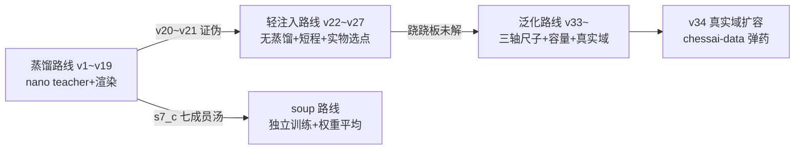

# GridHead 训练方法史（v1~v34 全记录）

> 生成时间：2026-10-06（v34 已终判）。素材来源：研发进度快照-20261006、新增文件清单 §七 登记日志、各轮 log.txt 与评测报告。
> 主线目标（用户拍板）：**完全替代 上游识别器项目 的 nano_v3 onnx，在精确度、泛化、路边摊识别上全面超过它，方法不限**。

---

## 〇、模型底座（全程不变的部分）

| 项 | 内容 |
|---|---|
| 架构 | GridHead CNN：输入 `[N,3,315,280]` → 输出 `[N,90,16]`（90 交点 × 16 类 `.×KABNRCPkabnrcp`） |
| 特征提取 | 四级 stride-8 通道（默认 width=(64,96,160,224)），head 1×1 压缩到 64 维 |
| 分类头 | **全盘共享一个 Linear(head_dim→16)**，stride-8 单点双线性采样，跨格零交互（架构形式 H9） |
| 默认参数量 | 132.3K（对比 nano_v3 = 7.60M int8 Swin，**差 57.5 倍**） |
| 端上约束 | int8 ≤1MB、单帧 CPU 推理 ms 级；fp32 1.9ms(132K)/6.9ms(1.128M) |
| 数据基本式 | 渲染合成（renderer.py，标签即真值）+ 真实域注入（伪标签：nano 两域投票质检） |

---

## 一、训练方法演化总览表

| 轮次 | 日期 | 核心方法 | 关键配方 | 结果 | 结论 |
|---|---|---|---|---|---|
| v1~v8 | 10-05 前 | **蒸馏奠基**：nano 当 teacher 蒸馏合成渲染域 | 大 batch、蒸馏 KL+CE | bench occ 90.5%，int8 0.70MB 定版一期~二期 | 蒸馏+渲染能学会屏域 |
| v9~v15 | 10-05 | 蒸馏深化：GPU 批量蒸馏集、边缘出界增广、bench 选点（v13~v15） | distill 12k~30k、--bench-select | v13 bench_best occ 93.88%；v15 加宽 338.5K 从头训全面不如 v14 | **容量假说第一次证伪（无配方配合）** |
| v16 | 10-05 | 屏域刷新：新采 54 帧从头训 | 原生屏域 | bench 1/10，不及 v14 | 屏域数据刷新≠涨点 |
| v17 | 10-05 | **实拍域注入**：爬虫图+视频帧伪标签 mix 1122 | v14 基座+轻注入 | 实物 17 帧 occ 76.8%→93.8%（nano 97.3%） | 真实域注入立竿见影 |
| v18 | 10-06 | **渲染器三处根因修复**再注入 | 修复版蒸馏 38k+真实集 11879 | App 域 occ 0.69→0.82，bench 历史新高 4/10；但实物 occ 崩到 75% | 根因修复有效；渲染先验与实物域在 132K 里冲突（跷跷板首现） |
| v19 | 10-06 | 照片重注入 150k | v18 基座 | 实物 occ 无法恢复（75%） | 跷跷板不是数据量问题 |
| v20~v21 | 10-06 | **扩容证伪轮**：net2net 函数保持扩宽 289.8K | 两种基座各一轮 | v20 26 帧 80 错不升反降；v21 实物 occ 0.7321 失败 | 扩容+蒸馏+长训=失败组合；"基座/局部最优"假说证伪 |
| v22~v24 | 10-06 | **轻注入配方确立（有效路线）** | v17bb 基座+照片池 50%+在线渲染 50%+**无蒸馏**+短程 80k~150k+**--human-select** | v22_hb 68 错→v24_hb 63 错（实物 0.8571/App 0.8740） | 去蒸馏+短程+实物导向选点=当前最优配方族 |
| soup_a/soup_b | 10-06 | **权重 soup**（独立训练成员平均） | 七成员 s7_c | **s7_c = 26 帧 58 错全局最优**（cell 0.9722/occ 0.8687） | soup 有效但成员必须独立训练；对汤微调破坏尖锐度（v28 证伪） |
| v25~v27 | 10-06 | bench 屏域攻坚 | bench_hot 移植集 7901 专精 | **v26_bb = bench 4/10、11 错格历史冠军** | 屏域移植+原生双路到方法天花板；与 26 帧是独立优化目标（双冠军策略） |
| v28~v32 | 10-06 | **证伪解剖轮**（六连） | 见 §三 | 全部证伪/无增益 | 瓶颈不在数据量，在 teacher 盲区与跷跷板 |
| 池审计 | 10-06 | 训练池洁化 | fitclean 1691（排废帧+学生一致率≥0.5） | 实锤 62 张废帧+浮字画风帧梯度干扰 | 标签系统性错误仅废帧一类；学生侧容量才是主矛盾 |
| **v33a/b** | 10-06 | **泛化轮：三轴尺子+双臂对照** | 见 §四 | A 臂三轴 +8~9pt/26 帧 77；**B 臂 1.128M 全面超 A（14087 错/26 帧 70）** | **分支①坐实：容量×好配方成立**（推翻"扩容无用"旧结论） |
| v34 | 10-06 | **chessai 真实域扩容**（进行中） | B 臂基座+五池 4119（+chessai 整图 904+贴片帧 1273） | gen 13572 错@step2675（已破 B 臂 14087） | 待终判 |

---

## 二、配方演化三条主线

1. **蒸馏路线（v1~v19）**：teacher（nano）伪标签/软标签 → 学生。前期奠基功不可没，后期天花板实测 **26%**（s7_c 58 错与 nano 19 错交集仅 15 格——74% 是"nano 对、学生错"，蒸馏无法传递 nano 没错的学生侧缺陷）。
2. **轻注入路线（v22~v27）**：无蒸馏、短程、照片池 50%、--human-select 实物导向选点。配方族地板 63~68 错，soup 后 58。
3. **泛化路线（v33~）**：主判据换泛化口径（style/piece/angle 三轴），--gen-select 泛化加权选点，容量放大 + 真实域数据扩容。

---

## 三、证伪清单（宝贵负知识，勿重蹈）

| # | 假说 | 验证轮 | 结果 |
|---|---|---|---|
| 1 | 加大容量能涨点（裸扩容） | v15（338.5K 从头训） | 全面不如 v14 |
| 2 | 扩容+蒸馏+长训 | v20/v21（289.8K，两种基座） | 26 帧 80 错退步；实物 occ 不动 |
| 3 | 对 soup 权重微调 | v28 | 62 错<58 反退——汤尖锐度被破坏，成员必须独立训练 |
| 4 | 输入级平移 TTA | tta_shift_eval | 81 错恶化——固定网格对平移敏感，warp 级 TTA 才可行（端上轮） |
| 5 | 占子阈值套利（降阈值捞漏子） | occ_margin_eval | 漏子近翻正仅 5~6 个，幻子多为自信错误，单调恶化 |
| 6 | 纯真实池（去渲染半区） | v31（real-ratio 1.0） | 80 错——渲染半区恰是学 App 主力 |
| 7 | 数据量级解决一切 | v29/v32（池 2488→3482，+40%） | 零增益——瓶颈在 teacher 盲区与跷跷板 |
| 8 | 自蒸馏是主天花板 | 误差交集归因 | **降级为次要**（天花板实数 26%） |
| 9 | "加宽无用"（旧结论） | v33 双臂 | **被推翻**——容量×泛化配方组合下 1.128M 全面超 132K |
| 10 | 换更大爬池更泛用 | v24→v29→v32 三连 | 无增益后转入池审计：62 张废帧+浮字帧是干扰源 |

---

## 四、v33 泛化轮（方法论转折点）

**背景**：用户拍板"加强模型必须走可泛化的路线——不能因为棋子改变、棋盘改变、拍摄角度改变导致识别不了"。归因诊断实锤：74% 错格是"nano 对、学生错"；七成员全票共错 40 格（系统性偏移）；26 帧口径的"追近"掩盖了泛化悬崖（style/piece occ 0.44 vs nano 0.93）。

**三轴泛化评测集**（留出纪律，永不入训）：
- `eval_gen_style.npz`：评测专属 8 系统字体 × 6 新主题，300 帧
- `eval_gen_angle.npz`：残差透视五档 R0~R4（角点 σ2→16px × 旋转 1.2°→5° × 梯形 1%→3.5%），300 帧
- `eval_gen_piece.npz`：真实棋子贴片贴渲染盘，teacher 质检，300 帧

**渲染器泛化化五连修**：①视差场增广 30%（立体棋子斜拍方向一致径向偏移）；②残差带宽校准（σ{2,4,8,12,16}/旋转 2.5°/梯形 2.5%）；③棋子级光照 55%；④随机板式 30%（HSV 全新配色+木纹）；⑤字形增广（加粗/变细/弹性波/斜切）+字体池扩容。

**双臂对照**（变量隔离：同配方只变容量）：

| | A 臂 v33a（132.3K） | B 臂 v33b（1.128M） |
|---|---|---|
| gen 选点 | 15008 错 | **14087 错** |
| style/piece/angle R4 occ | 0.536/0.521/0.454 | **0.576/0.558/0.496** |
| 26 帧 | 77 错 | **70 错** |
| bench | 1/10 | 1/10 |
| fp32 | 1.05MB/1.9ms | 5.02MB/6.9ms |

**判定**：分支①坐实——B 全面优于 A，"容量×好配方"成立；但泛化门（style≥nano−5pt 等）未达，1.128M 只吸收了部分冲突。**结论：主线=更大容量+真实域数据扩容**。

---

## 五、v34：chessai-data 真实域扩容（已终判）

**弹药**（外部数据集 nrl-ai/chessai-data，COCO 7 类越南语 868 图 18790 框，仅训练自用不分发）：
- 整图伪标注：876 唯一图 → pose 失败 20.7%（角度多样）→ teacher 低置信弃 243 → **904 样本（IGNORE 7.9%）**
- 贴片管线：18790 框方形裁剪 38×38 → nano 双色质检（argmax∈红黑两候选且 softmax≥0.55，**颜色由 teacher 判定**）→ **51% 通过 = 9670 贴片覆盖全部 16 类红黑** → 贴渲染盘收帧 1273

**配方**：B 臂 gen_best 基座（step2800）+ 1.128M 架构 + 五池 4119（mix 1942 + chessai 904 + 贴片帧 1273）+ 泛化渲染 50% + 无蒸馏 + lr 5e-5 余弦 + 150k 样本 + batch 48 + --gen-select。

**终判（分支①轨道延续）**：gen_best step2675 = **13572 错**（vs B 臂 14087）；
三轴 occ style **0.6075** / piece **0.5897** / angle R4 **0.5269**（再涨 3.1~3.2pt）；
**26 帧 occ 0.8994 = 全局历史新高**（超 s12_photo4 的 0.8743），69 错 / bench 22 错格 1/10 持平。
**泛化↑与 26 帧 occ↑ 首次同向**——跷跷板在"容量+真实域"配方下持续化解。
导出：fp32 7.3ms / int8 1.74MB 7.0ms（加速 nano 25.4 倍）；int8 与 fp32 一致率 91.06%（偏低，校准列入下轮）。

---

## 六、训练基建与纪律（踩坑换来的）

1. **选点纪律**：`--bench-select`（10 帧屏域）→ `--human-select`（26 帧分域）→ `--gen-select`（三轴 900 帧泛化加权）逐代演进；**评测集永不入训**（字体 GEN_HOLDOUT 3 体/评测专属 8 系统体/三轴 npz 全部留出）。
2. **蓝屏纪律**：v20 训练 commit 贴线（60.2~62.8/63.7GB）触发系统强制重启。教训：commit 大头在 CPU 侧固定占用（蒸馏集 8GB+真实池 5.5GB+workers），降 batch 无用、降蒸馏体量有效；安全配方 batch48/workers2/开训 10 分钟查 commit ≤55GB。
3. **数据纪律**：外部数据集仅训练自用、不分发、不进 git、记录出处（CITATION）；伪标签必经 teacher 双域投票+置信门槛；每次入训前池审计（废帧/一致率）。
4. **评测公理**：伪标签评测集上 teacher 必然满分（循环论证）——人工真值 26 帧才是金口径；但 26 帧会掩盖泛化悬崖——v33 起三轴口径为主、26 帧/bench 降为不退监控。
5. **net2net 函数保持扩宽**：logits 全等验证 1.91e-06，扩容不改函数——容量实验的干净起点。
6. **工程坑**（代表性）：cv2 中文路径用 fromfile+imdecode；MSYS 路径篡改用 MSYS_NO_PATHCONV；COCO 数据集内部去重会丢引用名（按引用清单收集）；onnxruntime CLS 常量归属模块先 grep 再用。
7. **自动化流水线**（2026-10-11）：`pipeline.py` 一键跑完 预检→watchdog→训练→fp32 三连导出→int8→三把尺评测→自动报告；配方在 `presets/*.json`（新配方加文件不改代码），预注册判据 gates 随配方走、报告自动判 PASS/FAIL。预检拦截 real-npz 静默跳过坑；watchdog 内置线程查 commit，超 58GB 自动终止训练（v20 蓝屏根治，ckpt 每 val 周期存盘可续训）；export 三连导完自动改名（覆盖坑根治）。训练精度自 v9 起实际是 bf16 autocast（L342 无条件生效），短程对照判数值无损，`--precision fp32` 供对照排障。AI 使用方式=点火 1 轮+读 `runs/<run>/自动报告.md` 1~2 轮，替代此前 30+ 轮巡检；**v36 提速方向修正：瓶颈在 CPU 渲染侧（主进程单核 95.3%），AMP/compile 收益预期下调，应攻渲染向量化**。

---

## 七、待办与下一步

- v34 终判（导出含 int8 → 三轴/26 帧/bench 三评 → 对照泛化门）
- 若泛化门仍远：更大容量阶梯（2M+/4M+，int8 后体积与耗时核算）× 池再扩（贴片池/整图池加码）
- 端上事项：warp 级多假设 TTA（端上轮）、int8 精度校验、App 集成切换
- 长期：人工仲裁 teacher 盲区帧、棋子分割模型替代圆 patch、自研 YOLO 检测线（YOLO 管线已架空，见 yolo-识别管线研究报告.md）

---

## 八、v55~v59 追加补账（2026-10-24 补写，含重大勘误）

> v55~v58 四轮详情见各自方案文档（docs/新增文件清单有登记），本节只记方法论结论与勘误。

### v55~v58 训练轮方法论沉淀（2026-10-20 四轮收官）

1. **权重插值打法（v56 首创）**：同血统权重（init 链同源）线性插值可组合"训两端端点"的进步——v49（实物端点）×v55（四轴端点）插出 w040 双优点，再×v56/hb 插出 hb_w08，再×v57/hb 插出 **r3_w085=终局最强单模型**（26 帧 v2 11/四轴 0.8576/0.8613/0.8665/0.7642）。**插值完点不能做训练 init**（v57 双退证伪：从双优平衡点出发被两向梯度拉扯）。
2. **跷跷板实锤（v55/v56 正反两证）**：26 帧实物域↔四轴泛化在单一训练轮内此消彼长；deploy 复选 rank 融合（rank(h)+rank(g) 最小）解决选点退化。
3. **26 帧小集判定力天花板**：±1-2 格不可判定（seed 抽样 ±3 格噪声带）；四轴 1200 帧 ±0.1pt 内为噪声。
4. **密排贴盘模式（v58）**：贴片从"空位贴"扩展"已占格真子替换"（dense 模式），对 26 帧无直接增益（端点 v2 18 弱于 v55 的 16），四轴微涨。
5. **训练/插值路线终局**：四轮训练+四轮插值 45+ 评测点收益 <0.2pt——配方层空间关闭。

### v59 系统超越轮（2026-10-24，docs/v59系统超越轮文档）

1. **级联三件套（零训练）**：r3_w085 低置信格（p<0.90，2.9% 格量）单向门控采纳 nano + 子数超编四档仲裁（nano 指认缺编类>r3 次选缺编>nano 说空格>r3 次选空格，迭代修复动态重算）+ 对换规则——**26 帧 v2 = 1 错格反超 nano（2）**；四轴级联口径 +2.5~+5.3pt；bench 8/10。
2. **子数规则分场景律**：真实对弈场景（盘面天然合规）三件套全开；渲染/泛化评测**仅级联**——渲染随机盘面不守子数规则，规则负贡献（piece L1 892→L2 1179 实测）。
3. **两模型错格完全不相交**（26 帧对账：r3 全部 11 错 nano 全对/nano 2 错 r3 全对）——级联有效性根基。

### ⚠️ 重大勘误：蒸馏死刑系冤案（v50 §1.3 判决作废）

- **原判**（v50 方案 §1.3，2026-10-19）："蒸馏路线死刑（实测）：渲染 60 帧现场重推 nano——占子格 argmax 判对率 0.0（100% 看成空格）……v50 起蒸馏槽永久关闭。"
- **平反实锤**（v59，2026-10-24）：batch=1 重测四轴渲染域 4800 帧，nano 占子格判对率 **style 0.7689 / piece 0.8144 / angle 0.7932 / roboflow 0.6995**（与官方四轴 nano occ 逐位一致）。原判 0.0 的签名（全空格+conf 崩 0.02-0.07）与 **BN 批污染**（v43 §6.1 发现的 nano batch>1 批统计算子污染，batch=256 同签名）完全一致；`distill_gen.py` teacher 默认 **batch=64**，v50 现场重推的 batch 配置未留痕（判决时批污染尚未发现）。
- **教训入纪律**：重大死刑判决必须留实验配置留痕（batch/精度/seed），签名雷同的病灶要交叉排查后再判。
- **重开范围**：渲染域硬标签/软标签蒸馏仍无价值（nano 渲染域 occ 0.70-0.81 仍弱于 r3 的 0.76-0.87）；**真实域帧上的 nano 软标签蒸馏**（传递真实域先验，MTPD 渐进技巧在案）重开为 v60 候选——级联已实证两模型互补性（错格零交集）。

### 架构裁决（v59，外部文献+内部考古双重证据）

- 不换范式：同类任务 2025-2026 仍主流"warp+整板+逐格分类"；小数据+强合成增广 CNN 不输 transformer 共识未翻案；真实域差距=数据域差距非架构差距。
- 容量阶梯 4M+（红队"假设未排除"）与 90-query 解码层（跨域增益文献支持）挂起，触发条件：级联残余 ≥2 且数据层打尽。
- 架构演进范式=v38a 增量手术模式（ReZero 零扰动+机制判据+延迟 A/B）。

### v60 蒸馏轮（2026-10-24 深夜，B 臂 FAIL 收官，docs/v60蒸馏轮方案 §六）

- **教训一：温度蒸馏对低区分度 teacher 失效（机理实锤）**——nano logits 值域仅 ±1（softmax top1=0.14），/T=4 后 teacher 分布≈均匀，KL 教的是"每类都差不多"（细分类抹平：step 50 cell 崩 86 错、四轴 -1~2pt、11 错格专项 0/11）。温度蒸馏的前提是 teacher logits 大间距（±5~30）；**对低置信 teacher 的正确方向是降温（T<1 放大差距）而非按文献惯例升温**。抽检一致率低的真因是低区分度不是噪声大——预案"一致率<85%→T 调 4"错在诊断。
- **教训二：TTA 路线二度证伪彻底关闭**——warp 级角点误差型扰动（缩放 ±2%+平移 ±2px，5 视图 logits 平均）26 帧 11→16（修 3 坏 8，红黑混淆 5/8 主导）：多视图平均把高置信稳定格的类间证据抹平。与当年输入级平移 TTA 失败同根，**GridHead 网格采样对几何扰动敏感是架构属性**，TTA 家族对本模型关闭。
- **教训三：纪律要有工具兜底才可信**——防泄漏 aHash 闸（v60 首次部署）当场揪出 10 帧评测帧 md5 全等泄漏（mix 2+v24 8，v1 建池时代混入、30 轮在场）：30 轮里"评测集永不入训"纪律靠自觉，欠账靠闸才现形。影响面：r3 见过还错 11 格=吃亏方，历史对比方向未逆转。
- **产出**：real17=10 单模型实物域历史最佳（v60/human_best.pt，real 端点材料）；train.py --distill-soft 槽（T/λ 可调，soft npz 存 logits）；12 池 nano soft 标签集（~126MB，T 换档零构建成本）。级联系统维持现役最优（26 帧 1 错）。

### v61 B2 臂与蒸馏死刑终判（2026-10-25 凌晨，docs/v60蒸馏轮方案 §七）

- 插值探索（v60/hb×r3_w085 三点）：无双优点，v60 占比单调变差，real 端优势不遗传权重空间。
- T=1（v61）：v2=19 更差、专项 0/11——与 T=4 同型 FAIL。**蒸馏死刑证据链完整**（与 v50 冤案
  性质不同：两轮预注册实验+机理解释，非配置假象）。
- **统一机理（方法论级教训）：决策有用、分布没用**——级联利用 teacher 的 argmax 决策互补性，
  蒸馏传递 teacher 的分布形态；当 teacher 分布区分度极低（值域 ±1/top1 0.14）且训练标签≈teacher
  决策（一致率 0.9999）时，软标签里没有任何可教的东西。**评估一个 teacher 的蒸馏价值先看两件事：
  分布区分度（softmax top1 间距）与标签增量（teacher argmax vs 现有标签的分歧里有多少是对的）**。
- 路线裁决：纯自研下一步=D3 90-query 解码层（v38a 手术模式），级联现役过渡。

### v62/v62b xattn 解码层手术双 FAIL（2026-10-25 凌晨，docs/v62方案 §七）

- **教训：ReZero 零扰动与"新模块快速激活"内在矛盾**——α 初值 0 时 α 的梯度 ∝ 分支输出与
  损失梯度的内积，天然趋零（v62：1250 步 α±0.0004，模块内部参数在学而门未开——"内部参数
  在动"≠"门开了"）。α=0.1 非零起步可破死区（v62b 起步扰动 99.6% 格一致可控）。
- **教训：增量手术前必须为模块设计激活路径与训练动态**——新模块需要的学习动态（长程/冻结
  两段式/专属 lr 配方）与宿主配方（快跑口径早停+微调 lr）不匹配时，模块在早停窗口内来不及
  产生可测收益即被停（v62b 定格 step 100，α 原地）。文献 decoder 是 45 epoch 从头冷训配方。
- **资产沉淀**：xattn 模块（+0.92M）、零扰动双级验证方法论（torch+onnx 逐位对拍）、pipeline
  训后链开关透传的坑（漏传=state_dict 崩但训练产物无损）。
