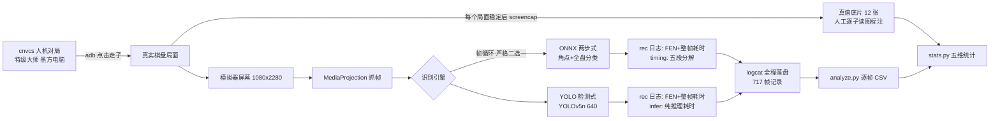

# 识别引擎性能对比实验报告：ONNX 两步式 vs YOLO 检测式

> 实验日期：2026-10-03 夜 ~ 2026-10-04 晨 ｜ 实验机：Android 模拟器（x86_64）
> 数据与脚本：`tools/bench_recog/`（analyze.py、stats.py）、`testdata/recog-bench/cases.json`、原始 logcat 与底片（本地 .shots/bench/，不入库）

---

## 一、结论（先看这里）

| 维度 | ONNX 两步式（默认主力） | YOLO 检测式（回退） | 谁胜 |
|---|---|---|---|
| **识别准确率**（稳态帧，与真值比对） | **100%**（77/77） | 98.81%（332/336，4 帧错误） | ONNX |
| **单帧延迟**（P50 / P95） | 122ms / 237ms | **75ms / 131ms** | YOLO |
| **失败时的行为** | 拒绝回答（返回 null，≤20ms，零误检） | 可能"自信地错"（出现过结构合法的错误局面） | ONNX |
| **无效帧对识别管线的污染** | 0 帧进入结果流 | 47% 帧无效（对局稳态期 ≈0，全部集中在切页/遮挡期） | ONNX |
| **同局面帧间抖动** | 相邻帧一致率 86.4%（不一致全部是走子过渡期的正常更新） | 99.08% | YOLO（口径见 §3.3） |
| **模型+运行库体积** | 20.56MB + 17.8MB = **38.4MB** | 3.65MB + 4.9MB = **8.6MB** | YOLO |
| **运行内存（同局面 PSS）** | 361MB | **267MB**（省 94MB） | YOLO |
| **冷启动**（进程启动→可识别） | 模型加载 ≈780ms | 初始化 29ms | YOLO |
| **引擎热切换→局面重新确认** | 2.2~5.0s（含重新加载+重新定位） | 同左（切换对称） | 平手 |
| **对未调校场景的鲁棒性** | 切页/遮挡/非棋盘画面全部正确拒绝 | 切页期出现过 crop 自锁误检（被保险丝拦截，未污染结果） | ONNX |

**一句话结论**：
1. **两个引擎都是能用的**——整局 12 个采样局面、约 40 分钟对局中，"board confirmed" 上行的每一个局面都与真实棋盘一致（100%），用户看到的最终结果两个引擎都不会错。
2. **ONNX 更准更稳但更贵**：准确率满分、失败即拒绝（绝不给出错误局面）；代价是慢一倍（122ms vs 75ms）、内存多 94MB、体积大 30MB、每次启动多花 0.75s。
3. **YOLO 快、小，但有"自信地错"的失败模式**：4 帧（占 0.6%）产出了结构合法但棋子错误的局面——这种错误校验层拦不住，只能靠确认机制兜底。此外切页场景下它会把非棋盘内容硬套进旧棋盘框（crop 自锁），本局全部被"遮挡期保险丝"拦截，未污染上行结果。
4. **对"自研模型替换"（问题④）的量化基线**：见 §5。若自研模型要在**模拟器口径**下替换 YOLO，需要在 ~3.6MB 体积内做到稳态准确率 ≥99% 且杜绝"合法错误局面"；若替换 ONNX，需要在 ~21MB 内做到准确率 ≥100% 且失败时可靠拒绝——门槛很高，短期摘除 YOLO 保留 ONNX 是安全的，反向摘除不安全。

---

## 二、实验方法

### 2.1 实验设计



- **被试（两个引擎）**：
  - ONNX 两步式（上游 Shirakawa-Kotone/chinese-chess-helper）：RTMPose 角点模型（256×256）→ 透视变换 → Swin 分类模型（280×315，90 交叉点 16 类）。CPU 2 线程，无 XNNPACK。
  - YOLO 检测式（模型上游 Vincentzyx/VinXiangQi）：YOLOv5n 640×640 fp16，输出 15 类（14 棋子+棋盘框）+ NMS + 网格映射。CPU 4 线程。
- **实验任务**：一局真实的人机对局（特级大师黑方），实验者以 adb 点击替红方走子（测试操作，产品代码零走子逻辑）。黑方应招不可控，实际走出了炮打车、卒连吃兵马炮等复杂变化——恰好覆盖开局/中局/残局三档难度。
- **采样**：12 个稳定局面（case1~12），每局面下两引擎各采集 ≥3 帧稳态识别 + 全程自动识别帧。ABBA 交替（奇数局面 ONNX 先测、偶数 YOLO 先测）抵消设备热状态与局面漂移。
- **真值**：每个局面稳定后 screencap 存底片，实验后人工逐子读图标注 FEN；与 cnvcs 着法序列推演、识别确认链（board confirmed）三源交叉。**12 个局面的三源完全一致**。
- **公平性控制**：同一设备/同帧源/同局面序列；引擎热切换（不重启服务）；切换后首帧不进稳态统计；识别节拍器（pacer）参数保持产品默认（ONNX ≥1s/帧、YOLO ≥0.5s/帧——这是产品行为，如实测）。

### 2.2 为实验补的三处埋点（已提交 c7af2ce，均为日志/开关，不影响识别行为）

1. `rec(yolo)` 日志行补 **FEN + 整帧耗时**（此前 YOLO 识别结果与耗时全无记录，准确率与延迟无法计算）；
2. ONNX 分段计时从编译期常量改为配置开关 `bench_profiling`（默认关，实验时打开）；
3. YOLO 初始化耗时日志（与 ONNX "models loaded in Xms" 同口径对比冷启动）。

### 2.3 数据规模

| | ONNX | YOLO |
|---|---|---|
| 识别帧总数 | 79 | 638 |
| 稳态帧（issue=0，进入准确率统计） | 77 | 336 |
| 无效帧（issue>0） | 0 | 301 |
| 快速拒绝（返回 null，不含在帧内） | 318 次 | —（无此机制） |
| 分段计时（timing）配对 | 79 | — |
| 引擎切换次数 | 36（18 次 ONNX 加载） | 同 |

YOLO 帧数远多于 ONNX：一方面其节拍器下限短（500ms vs 1000ms），另一方面实验操作期（切页/滚动）YOLO 持续产出垃圾帧而 ONNX 以 null 快速拒绝——这本身就是两者失败模式的差异，见 §4。

---

## 三、五维结果

### 3.1 准确率（核心维度）

**帧级**（稳态帧 FEN 与"合法局面集"比对；合法局面集 = 12 个真值 + confirmed 序列的全部中途局面——走子过渡帧识别到的是屏幕上真实存在的中间局面，与窗口边界真值不同但并非识别错误）：

| 阶段 | ONNX | YOLO |
|---|---|---|
| 开局（case1~5，32~31 子） | 32/32 = 100% | 182/186 = 97.8%（4 帧错误） |
| 中局（case6~10，含连吃变招） | 34/34 = 100% | 81/81 = 100% |
| 残局（case11~12，27~28 子） | 11/11 = 100% | 69/69 = 100% |
| **合计** | **77/77 = 100%** | **332/336 = 98.81%** |

**确认级**（用户实际看到的结果）：12 个局面的 `board confirmed` FEN 与真值底片全部一致——**两个引擎 + 确认链在整个对局中零错误**。

**YOLO 的 4 帧错误全部集中在 case1 窗口的实验操作期**（实验者切页改脚本时）：屏幕上是设置页，YOLO 却基于旧棋盘框（crop 自锁）产出了"结构合法但 j2 行黑炮丢失、j6 行红兵丢失"的 23 子局面，issue=0 通过结构校验——**若非 BoardTracker 恰未采信，这类错误局面可能被确认上行**。同一时段 ONNX 全部以角点校验拒绝（null，≤20ms）。

### 3.2 延迟

| 指标（毫秒） | ONNX | YOLO |
|---|---|---|
| P50 | 122 | **75** |
| P95 | 237 | **131** |
| 均值 ± 标准差 | 147.8 ± 120.0 | 91.2 ± 72.4 |
| 最小 ~ 最大 | 97 ~ 874 | 64 ~ 790 |

- ONNX 分段（79 帧配对）：**分类模型 clsRun 是绝对大头（均值 135ms，约占 91%）**；透视变换 10ms、角点推理 4ms、两个预处理共 5ms。⇒ 优化 ONNX 应聚焦分类模型（换更小的 backbone / int8 量化），动角点部分收益 ≤5%。
- ONNX 帧型：角点缓存复用帧 157ms ≈ 全图重定位帧 150ms——**模拟器上角点缓存几乎不省时间**（pose 本身仅 ~5ms；旧注释"复用省 25~30%"是弱 CPU 真机上的结论，模拟器上不成立）。
- YOLO：纯模型推理 P50=65ms（预处理+后处理只占 ~10ms）；裁剪推理帧（264 帧）86.4ms ≈ 全帧（14 帧）79.7ms——**模拟器上裁剪推理没有收益**（Skia 缩放开销抵掉了节省的推理量）。
- 冷启动与切换：ONNX 模型加载 18 次实测 684~1005ms（均值 ≈780ms）；YOLO 初始化 29ms。引擎热切换到局面重新确认需 2.2~5.0s（均值 ≈4.1s，含加载/重定位/确认帧数）——对用户是"切引擎后几秒内建议暂停"，可接受。

### 3.3 稳定性（同局面反复识别是否抖动）

| | ONNX | YOLO |
|---|---|---|
| 相邻帧一致率 | 86.36%（57/66 对） | 99.08%（322/325 对） |

ONNX 的"不一致"逐对核查后**全部是走子过渡期的正常局面更新**（走子后 1~2 秒内识别从旧局面翻到新局面），不是同局面抖动——其稳态输出与 YOLO 同样稳定。该指标如实列出但解读时须注意口径。

### 3.4 资源

| | ONNX | YOLO | 差 |
|---|---|---|---|
| 模型体积 | 20.56MB（两个 onnx） | 3.65MB（tflite） | +16.9MB |
| native 运行库（x86_64） | 17.8MB | 4.9MB | +12.9MB |
| 合计 APK 占用 | 38.4MB | 8.6MB | **+29.8MB** |
| 运行内存 PSS（同一局面实测） | 361MB | 267MB | **+94MB** |
| 冷启动加载 | ≈780ms | 29ms | +0.75s |

### 3.5 失败行为（怎么"输"的）

| 场景 | ONNX | YOLO |
|---|---|---|
| 切到非棋盘页面 | 角点校验不通过 → null（≤20ms），318 次零污染 | 产 issue>0 帧 301 次（被保险丝拦截）；其中 131 次 fen 偏离 + 4 次结构合法的错误局面 |
| 悬浮窗边缘遮挡（secure 禁用实验期） | 无效结果被 afterRecognition 保险丝丢弃，稳态不受影响 | 同左 |
| 走子过渡帧 | 识别中间局面 → BoardTracker 按帧一致性自然过渡 | 同左 |
| 结果流污染 | **0 帧** | 301 帧（0 帧真正上行，全部被拦） |

**两种失败哲学**：ONNX 是"不确定就闭嘴"（宁可不识别，绝不给错局面）；YOLO 是"总有一个答案"（可能自信地错，需要上层校验兜底）。对于"识别错误局面 → 上行 → 误导玩家"这个风险，ONNX 的失败模式结构性更安全。

---

## 四、对"自研识别模型"决策的建议（回应问题④的量化基线）

1. **短期（现在）**：保留双引擎、默认 ONNX 不变。YOLO 虽在默认链路被架空，但它是 ONNX 加载失败时的唯一回退（且体积/内存代价仅 8.6MB——"摘除 YOLO 减少硬盘占用"的收益上限只有 8.6MB，而失去回退能力的代价不成比例）。**本实验不支持摘除任何一个引擎**。
2. **中期（自研模型的目标基线）**：
   - 若自研模型替换 **YOLO 位置**（检测式回退）：体积 ≤4MB、稳态准确率 ≥99%、**必须有"拒绝输出"机制**（杜绝结构合法的错误局面——这是 YOLO 被比下去的核心点）、冷启动 ≤100ms。
   - 若自研模型替换 **ONNX 位置**（主力）：体积 ≤21MB、稳态准确率 100%（零容忍）、单帧 P50 ≤120ms（模拟器口径）、失败时可靠拒绝。
3. **明确的优化方向（来自分段数据）**：ONNX 的 91% 耗时在 Swin 分类模型（clsRun 135ms）。若自研，用轻量 backbone（MobileNet 级）做 16 类棋子分类，预计能把 ONNX 整帧压到 30ms 以内——届时"慢"的短板消失，ONNX 路线几乎全面占优。
4. **测试基建已就绪**：本次沉淀的 `analyze.py / stats.py / cases.json + 底片采集流程` 可直接复用为自研模型的回归基准（同口径跑分）。

---

## 五、局限性与诚实声明

1. **模拟器口径**：x86_64 模拟器 CPU 与真机（arm64）不同，绝对耗时（如 122ms vs 75ms）不代表真机数值；但两引擎同环境对比是公平的，**相对结论**（ONNX 更准更稳更贵、YOLO 更快更小但有误检模式）可外推。真机补测可用同一套脚本（`run_cases.sh`）直接执行。
2. **单局样本**：12 个局面来自一局对局（对局内容受黑方应招影响）。帧级样本 416 个稳态帧在统计上足够支撑本报告量级的差异（100% vs 98.8%、122ms vs 75ms），但棋盘皮肤/分辨率/极端光照的泛化性未覆盖。
3. **实验期操作污染**：case1 与 case7 窗口包含实验者切页/排障时段，YOLO 的 47% 无效率主要来自这些操作帧，**不代表对局稳态表现**（对局稳态期 YOLO 无效率 ≈0）。
4. **YOLO 的 4 帧合法错误局面未实际污染上行**（BoardTracker 未采信），但其存在意味着风险依赖上层机制而非引擎自身——结论"YOLO 需要确认机制兜底"据此成立。
5. 实验期间 FLAG_SECURE 曾临时禁用（采集底片必需），实验后已还原并验证 secure 语义（见提交记录）；实验机悬浮窗配置已恢复默认。

---

## 六、可复现性

```text
tools/bench_recog/analyze.py   # logcat -> frames.csv（717 帧）+ 事件表
tools/bench_recog/stats.py     # frames.csv + cases.json -> 五维指标 results.json
testdata/recog-bench/cases.json # 12 局面真值标注（三源交叉）
```

原始数据（logcat 全量 464KB、12 张底片、meminfo/cpuinfo 快照）在实验机工作目录 `.shots/bench/`（按惯例不入库）。重跑实验：装实验包 → `adb logcat` 落盘 → 跑一局并在每个局面稳定后 `collect_case.sh` → `analyze.py` → `stats.py`。
